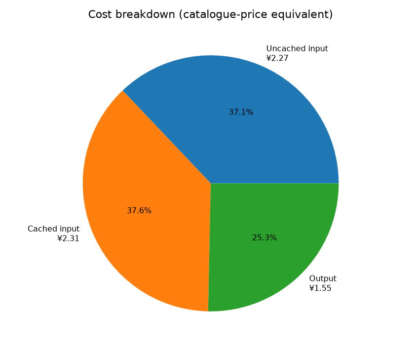

# CS2680 Assignment 3 运行报告 · Full Run 2

生成日期：2026-11-20 · 统计规则：每题计一次有效尝试（见 §9）

## 1. 概述

- **成绩：1/2（50.0%）**
- 模型：全程 `qwen3.8-flash`（standard 档，reasoning_effort=medium）；expert/starter 配置未启用
- 环境：Windows 16GB 笔记本 + WSL2 Docker VM 12GB，2 并发 × 4g 沙箱，1 并发评分
- 计费：Qwen 目录价等价（¥0.8/M 输入、¥0.1/M 缓存输入、¥2.7/M 输出），非实际现金支出（Token Plan 订阅额度）；美元按 7.1 折算

## 2. Agent 配置与设计

- **参照版本**：git `a731a16`（src/ 含未提交修改，见下）
- src 指纹（sha256 前 16 位）：`35f94e0bbf424fb2`

| 配置项 | 值 |
|---|---|
| MAX_ITERATIONS | `100` |
| MAX_OPEN_TASKS | `2` |
| API_RETRIES | `7` |
| API_BACKOFF_S | `4.0` |
| API_BACKOFF_MAX_S | `60.0` |
| PRESERVE_THINKING | `true` |
| MODEL_EXPERT | `qwen4-max` |
| MODEL_STANDARD | `qwen3.8-flash` |
| MODEL_STARTER | `qwen3.6-flash` |
| MODEL_EXTRA_BODY | `{"qwen4-max": {"reasoning_effort": "high"}, "qwen3.8-flash": {"reasoning_effort": "medium"}, "qwen3.6-flash": {"thinking_budget": 16384}}` |

**架构（三层）**

- 宿主调度器 `evaluation_scripts/run_all.py`：任务分配、沙箱生命周期、评分调度（不属于提交单元）。
- agent 容器 `src/`：ReAct 主循环，唯一提交单元；本报告的性能对比均以 `src/` 的版本为准。
- 每任务一个 Docker 沙箱（`sandbox_server.py` 提供文件/shell 操作，4g 内存上限）+ 独立评分容器（官方 verifier，断网）。

**主循环（agentic_loop.py）**

- ThreadPoolExecutor 并行，`MAX_OPEN_TASKS` 个 worker；每任务至多 `MAX_ITERATIONS` 轮。
- 每 `MAX_ITERATIONS/25` 轮注入进度提醒（PROGRESS_REMINDER）；同一文件读取达 3 次注入重复读取提醒。
- 任务异常隔离：单任务崩溃不影响其余任务；`solve()` 的 finally 提取并提交已有 diff（rescue submit）。

**模型调用**

- 单一档位 `MODEL_STANDARD`；`MODEL_EXTRA_BODY` 按模型注入 reasoning_effort 或 thinking_budget（二者互斥）。
- `PRESERVE_THINKING=1`：reasoning_content 回写 assistant 历史（Qwen preserve_thinking）。
- 瞬时故障重试 7 次指数退避（4s→60s），覆盖 408/409/429/5xx。
- 历史净化：畸形 `function.arguments` 在历史副本中归一为 `"{}"`（`_valid_arguments`），执行路径保留原始错误反馈给模型。

**上下文管理（memory.py，两层压缩）**

- 层 1（prompt_tokens ≥ 24K）：最近 12 条之外的工具输出归档，历史中保留头 400 + 尾 800 字符预览与归档引用；全文经 `read_archived_output` 按行号取回。
- 层 2（≥ 56K）：全量摘要 compaction，历史替换为 system + 摘要 + 当前计划 + git status/diff 快照（SUMMARY_CONTEXT_PROMPT）。

**工具集（7 个）**：read_file、read_archived_output、search（字面匹配）、edit_file、create_file、bash（拒绝 cat/sed/head/tail）、update_plan；scratch 文件限定 /work，避免污染补丁。

**系统提示词（prompts.py）**：预算、自主性、ground-truth（否定可靠记忆、防 PR-recall 螺旋）、行动偏向、工具纪律、验证六段；参考 openai/codex 编码提示词重写。

**追踪**：每任务 latency.jsonl（逐调用模型/延迟/token/缓存）+ run.jsonl（api_request/tool_call/tool_result/run_end）。

**未提交修改**（忽略换行符差异）：
```
assignment3/starter_code/src/agentic_loop.py
```

## 3. 版本变更

本轮：git `a731a16`，指纹 `35f94e0bbf424fb2`（含未提交修改）。

**相对 Full Run 1**（git `a731a16`，指纹 `3da72e34d286f470`）：代码有变更但不影响 agent 行为（仅 run_end 原因标注（iteration_limit/no_choices），属 trace 上报层，不参与决策）。
提交：
```
afa3045 feat(a3): read_file source pagination and atomic batch edit with replace_all
68c363f feat(a3): batch compaction with prefix-cache stability, unified config, tools/reports layout
```

文件变更：
```
assignment3/starter_code/src/agentic_loop.py   |  43 ++-
 assignment3/starter_code/src/config.py         |  98 ++++--
 assignment3/starter_code/src/memory.py         | 420 +++++++++++++++----------
 assignment3/starter_code/src/prompts.py        | 196 ++++++------
 assignment3/starter_code/src/sandbox.py        |   5 +-
 assignment3/starter_code/src/sandbox_server.py |  66 ++--
 assignment3/starter_code/src/tools.py          |  42 ++-
 7 files changed, 548 insertions(+), 322 deletions(-)
```

未提交修改（相对该参照提交）：
```
assignment3/starter_code/src/agentic_loop.py   |  43 +++++--
 assignment3/starter_code/src/config.py         |  98 ++++++++++----
 assignment3/starter_code/src/memory.py         | 172 +++++++++++++++++++------
 assignment3/starter_code/src/prompts.py        |  12 +-
 assignment3/starter_code/src/sandbox.py        |   5 +-
 assignment3/starter_code/src/sandbox_server.py |  66 +++++++---
 assignment3/starter_code/src/tools.py          |  42 ++++--
 7 files changed, 332 insertions(+), 106 deletions(-)
```


相对各参照均无行为级代码变更：逐题结果差异归因于模型采样随机性，不做性能对比。

## 4. 逐题结果

| 题目 | 结果 | 轮数 | 墙钟 min | 模型 min | 输入 M | 输出 K | 缓存% | 花费 ¥ |
|---|---|---:|---:|---:|---:|---:|---:|---:|
| ansible/83909bf | PASS | 53 | 12.9 | 9.9 | 1.60 | 25.1 | 81.6 | 0.434 |
| qutebrowser/21b426b | FAIL | 85 | 21.0 | 16.2 | 2.59 | 43.5 | 79.3 | 0.753 |

## 5. 汇总指标

| 指标 | 数值 |
|---|---|
| API 调用 | 141 次，平均 11.1 s/次 |
| Token 总量 | 输入 4.19M / 输出 68.6K（61:1），缓存命中 80.1% |
| 平均解题时间 | **12.9 min**（中位 12.9；最快 12.9，最慢 12.9） |
| 任务墙钟总和 | 0.56 h（2 并发，实际历时更短）；模型推理 0.43 h，占 77% |
| **总花费（目录价等价）** | **¥1.19 ≈ $0.17** |
| 成本构成 | 未缓存输入 ¥0.67（56%）+ 缓存输入 ¥0.34（28%）+ 输出 ¥0.19（16%） |
| 平均每题花费 | ¥0.59 |
| 平均每个胜题花费 | ¥1.19 ≈ **$0.167/solved** |
| 胜题单次成本 | 最低 ¥0.43，最高 ¥0.43 |

compaction 调用未记录 usage，成本低估可忽略。



## 6. Agent 行为分析

数据源：run.jsonl 的 tool_call/tool_result 事件；思维链总结基于 agent.log 的 [thinking] 记录（run5 缺失，据工具序列重建）。重复浪费 = 工具名与参数完全相同的多余调用次数；高频重读 = 同一文件以不同行段反复读取。

| 题目 | 工具分布 | 首编辑轮 | 编辑次数 | 测试命令 | 重复浪费 | 错误结果 |
|---|---|---:|---:|---:|---:|---:|
| ansible/83909bf | bash34 read14 search13 plan3 edit2 | 26 | 2 | 9 | 0 | 2/66 |
| qutebrowser/21b426b | bash64 edit12 read11 search3 plan3 | 9 | 12 | 34 | 0 | 0/93 |

**动作耗时（全部题目合计）**：

| 工具 | 次数 | 总耗时 min | 平均 s | 最大 s |
|---|---:|---:|---:|---:|
| bash | 98 | 5.6 | 3.4 | 49 |
| search | 16 | 0.1 | 0.2 | 1 |
| read_file | 25 | 0.0 | 0.0 | 0 |
| edit_file | 14 | 0.0 | 0.0 | 0 |
| update_plan | 6 | 0.0 | 0.0 | 0 |

**压缩发生（层 1 工具归档 / 层 2 摘要压缩）**：

| 题目 | 层1 次数 | 层1 发生分布 | 层2 次数 | 层2 发生轮 |
|---|---:|---|---:|---|
| ansible/83909bf | — | — | 0 | 无 |
| qutebrowser/21b426b | — | — | 1 | turn 68 |

层 1 触发阈值 prompt_tokens ≥ 24K、层 2 ≥ 56K（memory.py）。层 1 计数依赖 agent.log 的 live 输出（run5 该目录丢失，四题记为 —）；层 2 来自 latency.jsonl，始终可靠。


**自动标记**：

- ansible/83909bf：首编辑迟至第 26 轮；高频重读 galaxy.py ×7（不同行段）
- qutebrowser/21b426b：高频重读 configutils.py ×7（不同行段）

**逐题行为与思维链总结**：

### ansible/83909bf

与 Full Run 1 的重写相反：本次保留原报错骨架、仅删除 login 子句（"...--api-key or at {token path}"），恰好命中 gold 前缀；全程仅 2 次 edit_file（Full Run 1 为 17 次），首编辑 turn 26，调研含对上游 PR 历史的回忆。53 轮、12.9 min、0/150 通过——最小变更纪律直接决定精确字符串题的成败。

### qutebrowser/21b426b

思维明确注意到"可见测试期望 values=[...]，但隐藏测试可能已更新"，仍锚定旧可见测试格式，做出与 Full Run 1 完全相同的列表归一化（values=list(self._vmap.values())）；85 轮中 bash 64 次，多耗在全量套件崩溃排查与 stash 对比，首编辑 turn 9。零反馈重跑复现同一格式选择，证实该偏差是确定性的。


## 7. Token 用量分析

1. **输入:输出 = 61:1**：agent 负载的成本主体是反复提交上下文，而非生成。80% 的缓存命中节省约 ¥2.4；若无前缀缓存，总成本约为 ¥3.5。前缀缓存是该 harness 中价值最高的机制，compaction 策略（减少触发、触发后保持前缀稳定）直接决定成本。
2. **输出仅占 token 的 1.6%，却占成本 16%**；未缓存输入占 token 20%、占成本 56%。压缩成本的两个杠杆：减少上下文失效、控制输出长度。reasoning_effort=medium 下平均输出 486 tok/call、平均延迟 11.1 s。


## 8. 失败案例分析

- qutebrowser/21b426b：1/28 个测试未通过（官方 verifier）。根因分析见 Full Run 1 报告失败案例分析章节。

## 9. 统计方法说明

- **每题计一次有效尝试**：通过题取首次通过的尝试；未通过题取最后一次有效评分（官方 verifier 链路）。因崩溃、OOM、编排器故障、verifier 缺陷或模型行为异常而无效的尝试不计入时间与成本。
- 尝试按 hostlog 运行 ID 分组，本报告只含本轮尝试。
- **本轮性质**：思维明确注意到"可见测试期望 values=[...]，但隐藏测试可能已更新"，仍锚定旧可见测试格式，做出与 Full Run 1 完全相同的列表归一化（values=list(self._vmap.values())）；85 轮中 bash 64 次，多耗在全量套件崩溃排查与 stash 对比，首编辑 turn 9。零反馈重跑复现同一格式选择，证实该偏差是确定性的。
- 耗时 = trace 首末事件时间差；成本按目录价逐调用累加；compaction 调用无 usage 记录，未计入。
- 任务归属按 hostlogs 任务表快照 + trace 位置序号对齐；无 results.md 的轮次以 evaluations.tsv 补充判定。
- 排行榜数据取自截止后的静态 API（作业已关闭，无新增提交）。
