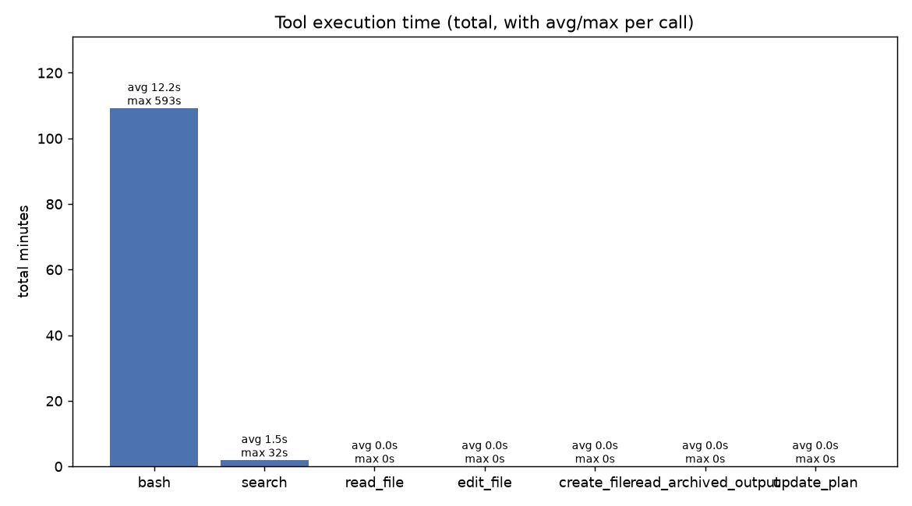

# CS2680 Assignment 3 运行报告 · Full Run 3

生成日期：2026-11-20 · 统计规则：每题计一次有效尝试（见 §10）

## 1. 概述

- **成绩：12/15（80.0%）**
- 模型：全程 `qwen3.8-flash`（standard 档，reasoning_effort=medium）；expert/starter 配置未启用
- 环境：Windows 16GB 笔记本 + WSL2 Docker VM 12GB，2 并发 × 4g 沙箱，1 并发评分
- 计费：Qwen 目录价等价（¥0.8/M 输入、¥0.1/M 缓存输入、¥2.7/M 输出），非实际现金支出（Token Plan 订阅额度）；美元按 7.1 折算

## 2. Agent 配置与设计

- **参照版本**：git `3217cd8`（工作树干净）
- src 指纹（sha256 前 16 位）：`9f11234ff2055239`

| 配置项 | 值 |
|---|---|
| MAX_ITERATIONS | `100` |
| MAX_OPEN_TASKS | `2` |
| API_RETRIES | `7` |
| API_BACKOFF_S | `4.0` |
| API_BACKOFF_MAX_S | `60.0` |
| PRESERVE_THINKING | `true` |
| MODEL_EXPERT | `qwen4-max` |
| MODEL_STANDARD | `qwen3.8-flash` |
| MODEL_STARTER | `qwen3.6-flash` |
| MODEL_EXTRA_BODY | `{"qwen4-max": {"reasoning_effort": "high"}, "qwen3.8-flash": {"reasoning_effort": "medium"}, "qwen3.6-flash": {"thinking_budget": 16384}}` |
| TOOL_COMPACT_THRESHOLD | `40000` |
| ARCHIVE_HYSTERESIS_TOKENS | `8000` |
| WINDOW_TOKEN_BUDGET | `8000` |
| BASH_INSERT_MIN_CHARS | `2000` |
| SUMMARY_COMPACT_THRESHOLD | `56000` |

**架构（三层）**

- 宿主调度器 `evaluation_scripts/run_all.py`：任务分配、沙箱生命周期、评分调度（不属于提交单元）。
- agent 容器 `src/`：ReAct 主循环，唯一提交单元；本报告的性能对比均以 `src/` 的版本为准。
- 每任务一个 Docker 沙箱（`sandbox_server.py` 提供文件/shell 操作，4g 内存上限）+ 独立评分容器（官方 verifier，断网）。

**主循环（agentic_loop.py）**

- ThreadPoolExecutor 并行，`MAX_OPEN_TASKS` 个 worker；每任务至多 `MAX_ITERATIONS` 轮。
- 每 `MAX_ITERATIONS/25` 轮注入进度提醒（PROGRESS_REMINDER）；同一文件读取达 3 次注入重复读取提醒。
- 任务异常隔离：单任务崩溃不影响其余任务；`solve()` 的 finally 提取并提交已有 diff（rescue submit）。

**模型调用**

- 单一档位 `MODEL_STANDARD`；`MODEL_EXTRA_BODY` 按模型注入 reasoning_effort 或 thinking_budget（二者互斥）。
- `PRESERVE_THINKING=1`：reasoning_content 回写 assistant 历史（Qwen preserve_thinking）。
- 瞬时故障重试 7 次指数退避（4s→60s），覆盖 408/409/429/5xx。
- 历史净化：畸形 `function.arguments` 在历史副本中归一为 `"{}"`（`_valid_arguments`），执行路径保留原始错误反馈给模型。

**上下文管理（memory.py，两层压缩 · V6 重设计）**

- 层 1 批量归档：prompt_tokens ≥ 40K 且距上次归档增长 ≥ 8K 才触发；活窗口 = 尾部累计 ≤ 8K token 的工具输出（无条数约束）；原始 ≥ 2× 预览（1200 字符）才归档为 600 字符预览（头 100/尾 500）+ 引用；水位线以下永不改写——两次批量之间请求前缀逐字节稳定，最大化前缀缓存命中。
- bash 出生即预览：≥ 2000 字符的 bash 输出在插入时即归档（头 100/尾 900，全文可 `read_archived_output` 按行取回），此后永不改写；trace 仍记全文。
- 层 2（≥ 56K）：全量摘要 compaction，历史替换为 system + 摘要 + 当前计划 + git status/diff 快照 + **结构化状态块**（已读/已改文件、scratch、最近命令、归档索引），压缩后取回通路不断头。

**工具集（7 个）**：read_file、read_archived_output、search（字面匹配）、edit_file、create_file、bash（拒绝 cat/sed/head/tail）、update_plan；scratch 文件限定 /work，避免污染补丁。

**系统提示词（prompts.py）**：预算、自主性、ground-truth（否定可靠记忆、防 PR-recall 螺旋）、行动偏向、工具纪律、验证六段；参考 openai/codex 编码提示词重写。

**追踪**：每任务 latency.jsonl（逐调用模型/延迟/token/缓存）+ run.jsonl（api_request/tool_call/tool_result/run_end）。

## 3. 版本变更

本轮：git `3217cd8`，指纹 `9f11234ff2055239`。

**相对 Full Run 2**（git `a731a16`，指纹 `35f94e0bbf424fb2`）：代码有变更（行为级）。
提交：
```
68c363f feat(a3): batch compaction with prefix-cache stability, unified config, tools/reports layout
```

文件变更：
```
assignment3/starter_code/src/agentic_loop.py |  34 ++-
 assignment3/starter_code/src/config.py       |  94 ++++--
 assignment3/starter_code/src/memory.py       | 413 ++++++++++++++++-----------
 assignment3/starter_code/src/prompts.py      | 191 +++++++------
 4 files changed, 442 insertions(+), 290 deletions(-)
```


配置变更：

| 配置项 | 参照 | 本轮 |
|---|---|---|
| TOOL_COMPACT_THRESHOLD | None | 40000 |
| ARCHIVE_HYSTERESIS_TOKENS | None | 8000 |
| WINDOW_TOKEN_BUDGET | None | 8000 |
| BASH_INSERT_MIN_CHARS | None | 2000 |
| SUMMARY_COMPACT_THRESHOLD | None | 56000 |

**相对 Full Run 1**（git `a731a16`，指纹 `3da72e34d286f470`）：代码有变更（行为级）。
提交：
```
68c363f feat(a3): batch compaction with prefix-cache stability, unified config, tools/reports layout
```

文件变更：
```
assignment3/starter_code/src/agentic_loop.py |  34 ++-
 assignment3/starter_code/src/config.py       |  94 ++++--
 assignment3/starter_code/src/memory.py       | 413 ++++++++++++++++-----------
 assignment3/starter_code/src/prompts.py      | 191 +++++++------
 4 files changed, 442 insertions(+), 290 deletions(-)
```


## 4. 性能对比

仅对比两轮共同题目；Δ = (本轮 − 参照) / 参照。无行为级变更的参照不做性能对比（差异仅为采样噪声）。

### 相对 Full Run 2

| 题目 | 结果 参→本 | 墙钟 min 参→本 | Δ墙钟 | 花费 ¥ 参→本 | Δ花费 |
|---|---|---|---:|---|---:|
| ansible/83909bf | PASS→FAIL | 12.9→16.3 | +26% | 0.434→0.370 | -15% |
| qutebrowser/21b426b | FAIL→FAIL | 21.0→10.9 | -48% | 0.753→0.238 | -68% |

**汇总对比（仅共同题目，相对 Full Run 2）**：

| 指标 | Full Run 2 | 本轮 | Δ |
|---|---:|---:|---:|
| 解题数 | 1/2 | 0/2 | -1 |
| 花费 ¥ | 1.19 | 0.61 | -49% |
| 平均解题时间 min | 12.9 | 0.0 | -100% |
| $/solved | 0.167 | 0.000 | -100% |

共同题目中 1 题明显更快（墙钟降幅 >5%），1 题明显更慢。
### 相对 Full Run 1

| 题目 | 结果 参→本 | 墙钟 min 参→本 | Δ墙钟 | 花费 ¥ 参→本 | Δ花费 |
|---|---|---|---:|---|---:|
| ansible/f327e65 | PASS→PASS | 60.6→14.4 | -76% | 0.724→0.192 | -73% |
| element-hq/5dfde12 | PASS→PASS | 45.0→39.6 | -12% | 0.916→0.764 | -17% |
| flipt-io/2ca5dfb | PASS→PASS | 31.1→38.1 | +23% | 0.768→0.520 | -32% |
| flipt-io/2eac0df | PASS→PASS | 11.2→21.1 | +89% | 0.113→0.383 | +240% |
| future-architect/5af1a22 | PASS→PASS | 24.3→39.3 | +62% | 0.205→0.447 | +118% |
| gravitational/1316e67 | PASS→PASS | 33.7→29.6 | -12% | 1.098→0.586 | -47% |
| gravitational/89f0432 | PASS→PASS | 18.2→26.7 | +47% | 0.399→0.489 | +22% |
| internetarchive/4a5d2a7 | PASS→PASS | 5.9→1.9 | -69% | 0.157→0.036 | -77% |
| internetarchive/53d376b | PASS→PASS | 20.7→18.1 | -12% | 0.712→0.403 | -43% |
| protonmail/944adbf | PASS→PASS | 7.8→9.7 | +25% | 0.061→0.041 | -33% |
| qutebrowser/c580ebf | PASS→PASS | 20.0→32.5 | +63% | 0.385→0.586 | +52% |
| qutebrowser/de4a1c1 | PASS→PASS | 25.5→26.6 | +4% | 0.733→0.663 | -10% |
| ansible/83909bf | FAIL→FAIL | 16.8→16.3 | -3% | 0.657→0.370 | -44% |
| ansible/a26c325 | PASS→FAIL | 16.8→14.3 | -15% | 0.594→0.395 | -34% |
| qutebrowser/21b426b | FAIL→FAIL | 6.8→10.9 | +61% | 0.117→0.238 | +103% |

**汇总对比（仅共同题目，相对 Full Run 1）**：

| 指标 | Full Run 1 | 本轮 | Δ |
|---|---:|---:|---:|
| 解题数 | 13/15 | 12/15 | -1 |
| 花费 ¥ | 7.64 | 6.11 | -20% |
| 平均解题时间 min | 24.7 | 24.8 | +1% |
| $/solved | 0.083 | 0.072 | -13% |

共同题目中 6 题明显更快（墙钟降幅 >5%），7 题明显更慢。

任务集不同时解题数不可直接比。

## 5. 逐题结果

| 题目 | 结果 | 轮数 | 墙钟 min | 模型 min | 输入 M | 输出 K | 缓存% | 花费 ¥ |
|---|---|---:|---:|---:|---:|---:|---:|---:|
| ansible/f327e65 | PASS | 42 | 14.4 | 7.9 | 0.98 | 20.6 | 94.3 | 0.192 |
| element-hq/5dfde12 | PASS | 96 | 39.6 | 27.9 | 3.39 | 67.5 | 89.7 | 0.764 |
| flipt-io/2ca5dfb | PASS | 73 | 38.1 | 18.4 | 2.26 | 42.7 | 88.6 | 0.520 |
| flipt-io/2eac0df | PASS | 55 | 21.1 | 11.4 | 2.07 | 25.6 | 92.6 | 0.383 |
| future-architect/5af1a22 | PASS | 42 | 39.3 | 17.5 | 1.27 | 51.7 | 79.7 | 0.447 |
| gravitational/1316e67 | PASS | 69 | 29.6 | 20.9 | 2.15 | 59.4 | 86.0 | 0.586 |
| gravitational/89f0432 | PASS | 82 | 26.7 | 14.9 | 2.94 | 29.9 | 94.5 | 0.489 |
| internetarchive/4a5d2a7 | PASS | 14 | 1.9 | 1.1 | 0.13 | 3.7 | 85.2 | 0.036 |
| internetarchive/53d376b | PASS | 45 | 18.1 | 16.8 | 1.34 | 47.1 | 84.9 | 0.403 |
| protonmail/944adbf | PASS | 17 | 9.7 | 1.7 | 0.16 | 3.9 | 87.4 | 0.041 |
| qutebrowser/c580ebf | PASS | 97 | 32.5 | 20.4 | 2.94 | 43.5 | 91.6 | 0.586 |
| qutebrowser/de4a1c1 | PASS | 99 | 26.6 | 21.7 | 3.03 | 54.6 | 90.0 | 0.663 |
| ansible/83909bf | FAIL | 48 | 16.3 | 13.2 | 1.76 | 33.7 | 91.7 | 0.370 |
| ansible/a26c325 | FAIL | 62 | 14.3 | 12.7 | 2.10 | 29.3 | 92.8 | 0.395 |
| qutebrowser/21b426b | FAIL | 44 | 10.9 | 8.1 | 1.23 | 18.6 | 92.4 | 0.238 |

## 6. 汇总指标

| 指标 | 数值 |
|---|---|
| API 调用 | 907 次，平均 14.2 s/次 |
| Token 总量 | 输入 27.75M / 输出 531.6K（52:1），缓存命中 90.2% |
| 平均解题时间 | **24.8 min**（中位 26.7；最快 1.9，最慢 39.6） |
| 任务墙钟总和 | 5.65 h（2 并发，实际历时更短）；模型推理 3.58 h，占 63% |
| **总花费（目录价等价）** | **¥6.11 ≈ $0.86** |
| 成本构成 | 未缓存输入 ¥2.18（36%）+ 缓存输入 ¥2.50（41%）+ 输出 ¥1.44（23%） |
| 平均每题花费 | ¥0.41 |
| 平均每个胜题花费 | ¥0.51 ≈ **$0.072/solved** |
| 胜题单次成本 | 最低 ¥0.04，最高 ¥0.76 |

compaction 调用未记录 usage，成本低估可忽略。


## 7. Agent 行为分析

数据源：run.jsonl 的 tool_call/tool_result 事件；思维链总结基于 agent.log 的 [thinking] 记录（run5 缺失，据工具序列重建）。重复浪费 = 工具名与参数完全相同的多余调用次数；高频重读 = 同一文件以不同行段反复读取。

| 题目 | 工具分布 | 首编辑轮 | 编辑次数 | 测试命令 | 重复浪费 | 错误结果 |
|---|---|---:|---:|---:|---:|---:|
| ansible/f327e65 | bash27 search9 read8 edit6 plan2 | 16 | 7 | 11 | 0 | 0/54 |
| element-hq/5dfde12 | bash67 read30 edit14 search8 plan5 | 44 | 15 | 14 | 3 | 2/126 |
| flipt-io/2ca5dfb | bash49 edit20 read16 search3 plan3 | 14 | 23 | 11 | 1 | 1/97 |
| flipt-io/2eac0df | bash40 read16 edit16 plan4 search2 | 13 | 16 | 7 | 2 | 0/79 |
| future-architect/5af1a22 | read18 bash16 search8 edit8 plan4 | 14 | 8 | 4 | 1 | 1/54 |
| gravitational/1316e67 | bash34 edit21 read15 search4 plan3 | 8 | 22 | 9 | 1 | 0/80 |
| gravitational/89f0432 | bash51 edit22 read16 search4 create3 | 5 | 25 | 14 | 0 | 1/100 |
| internetarchive/4a5d2a7 | bash7 search3 read2 plan2 edit2 | 5 | 2 | 5 | 0 | 0/17 |
| internetarchive/53d376b | bash28 read16 search10 edit5 plan4 | 21 | 5 | 9 | 1 | 1/65 |
| protonmail/944adbf | bash11 read3 plan2 create2 edit2 | 4 | 4 | 6 | 0 | 0/21 |
| qutebrowser/c580ebf | bash65 read21 edit12 plan4 archive3 | 8 | 13 | 46 | 0 | 0/108 |
| qutebrowser/de4a1c1 | bash52 read28 edit17 search10 plan3 | 9 | 20 | 30 | 2 | 4/114 |
| ansible/83909bf | bash30 read15 edit15 plan3 archive3 | 22 | 16 | 9 | 0 | 1/69 |
| ansible/a26c325 | bash39 edit30 read14 plan4 archive2 | 18 | 32 | 9 | 1 | 1/91 |
| qutebrowser/21b426b | bash23 search10 read9 edit7 plan2 | 13 | 7 | 12 | 0 | 0/52 |

**动作耗时（全部题目合计）**：

| 工具 | 次数 | 总耗时 min | 平均 s | 最大 s |
|---|---:|---:|---:|---:|
| bash | 539 | 109.1 | 12.2 | 593 |
| search | 75 | 1.9 | 1.5 | 32 |
| read_file | 227 | 0.0 | 0.0 | 0 |
| edit_file | 197 | 0.0 | 0.0 | 0 |
| create_file | 18 | 0.0 | 0.0 | 0 |
| read_archived_output | 24 | 0.0 | 0.0 | 0 |
| update_plan | 47 | 0.0 | 0.0 | 0 |

**压缩发生（层 1 工具归档 / 层 2 摘要压缩）**：

| 题目 | 层1 次数 | 层1 发生分布 | 层2 次数 | 层2 发生轮 |
|---|---:|---|---:|---|
| ansible/f327e65 | 0 | 无 | 0 | 无 |
| element-hq/5dfde12 | 4 | turn 26（×9），turn 44（×7），turn 80（×3），turn 90（×3） | 1 | turn 56 |
| flipt-io/2ca5dfb | 2 | turn 30（×2），turn 44（×6） | 1 | turn 57 |
| flipt-io/2eac0df | 2 | turn 11（×4），turn 45（×3） | 0 | 无 |
| future-architect/5af1a22 | 2 | turn 15（×1），turn 23（×2） | 1 | turn 28 |
| gravitational/1316e67 | 3 | turn 15（×1），turn 25（×1），turn 65（×6） | 1 | turn 31 |
| gravitational/89f0432 | 2 | turn 39（×5），turn 71（×5） | 0 | 无 |
| internetarchive/4a5d2a7 | 0 | 无 | 0 | 无 |
| internetarchive/53d376b | 2 | turn 17（×5），turn 23（×2） | 1 | turn 29 |
| protonmail/944adbf | 0 | 无 | 0 | 无 |
| qutebrowser/c580ebf | 2 | turn 33（×10），turn 55（×4） | 1 | turn 75 |
| qutebrowser/de4a1c1 | 4 | turn 28（×5），turn 44（×6），turn 53（×3），turn 99（×5） | 1 | turn 53 |
| ansible/83909bf | 2 | turn 22（×4），turn 40（×4） | 0 | 无 |
| ansible/a26c325 | 2 | turn 28（×7），turn 50（×3） | 0 | 无 |
| qutebrowser/21b426b | 1 | turn 37（×5） | 0 | 无 |

层 1：≥40K 且距上次归档 ≥8K 触发；窗口 = 尾部 ≤8K token；原始 ≥1200 字符才归档；bash ≥2000 字符出生即预览（不计入层 1 事件）；层 2 ≥56K（config.py）。层 1 计数依赖 agent.log；层 2 来自 latency.jsonl。





**自动标记**：

- ansible/f327e65：首编辑迟至第 16 轮
- element-hq/5dfde12：首编辑迟至第 44 轮
- flipt-io/2ca5dfb：高频重读 metrics.go ×6（不同行段）
- flipt-io/2eac0df：高频重读 telemetry_test.go ×6（不同行段）
- gravitational/1316e67：高频重读 dynamoevents.go ×12（不同行段）
- internetarchive/53d376b：首编辑迟至第 21 轮
- qutebrowser/c580ebf：高频重读 test_hostblock.py ×6（不同行段）
- qutebrowser/de4a1c1：高频重读 test_configinit.py ×14（不同行段）
- ansible/83909bf：首编辑迟至第 22 轮
- ansible/a26c325：首编辑迟至第 18 轮

**逐题行为与思维链总结**：

### ansible/f327e65

43 轮、首编辑 turn 15，全程无批量归档、仅一次出生预览回读，是轻压缩样本；正确诊断 galaxy 依赖循环导入为既有问题，175 测试全过，模型时间仅 7.9 min（基准轮 60.6 min 的同题），效率标杆。

### element-hq/5dfde12

97 轮近上限、126 次调用、bash 67，首编辑迟至 turn 43——TS 大库前期调研过重是最大低效点。三批归档 + 一次摘要压缩（约 turn 56），压缩后重读源文件再续改，应对正常；0/61 通过但轮次/工具数全场最高，性价比偏低。

### flipt-io/2ca5dfb

74 轮、bash 49 次的 Go 改-编译-测循环，首编辑 turn 13。两批归档后约 turn 57 摘要压缩（prompt 缩至 ~6.7K），压缩后立即重跑 go test、重读 metrics_test.go 做有意再校准而非迷失；处理了 TestLoad 的 Default()/Load 一致性，0/2 通过。

### flipt-io/2eac0df

56 轮、首编辑 turn 12，两批归档、未触发摘要压缩；对 analytics payload 的精确 map 断言逐处核对（三处出现点逐一处理），1 次归档回读；末尾自行判断不必加 CHANGELOG，0/3 通过，无返工。

### future-architect/5af1a22

43 轮，首编辑 turn 13，一批归档 + 一次摘要压缩（约 turn 30），压缩后行为连贯。对"是否可改既有测试"边界判断正确（因签名变化更新 scanner 测试并补新用例），0/11 通过，节奏紧凑无冗余。

### gravitational/1316e67

70 轮，首编辑很早（turn 7）、edit 21 次边理解边改；两批归档且摘要压缩几乎同轮完成，压缩后未见重复读取。亮点：scratch 假服务器验证 spec 行为后删除临时文件，自我约束好，0/5 通过（基准轮此题贴 99 轮上限，本轮 70 轮收敛）。

### gravitational/89f0432

83 轮、edit 22 / bash 51，首编辑 turn 4；两批归档但从未摘要压缩，压缩后无迷失。ioutil→io 全库清扫 + fake-server 测试耗时较多——只考 1 个测试用 83 轮，是"通过但开销/收益失衡"的代表。

### internetarchive/4a5d2a7

全程最轻：15 轮、17 次调用、首编辑 turn 4、零归档事件；先自写复现脚本验证 get_statement_values 行为再动手，既改测试又验证，9 个测试全过。

### internetarchive/53d376b

46 轮（bash28/read16/edit5），首编辑 turn 20，探索→定点修改→pytest 节奏。两批归档后约 turn 20 余触发摘要压缩；agent 察觉归档窗口把 load_book.py 全文读截断（import 行不完整），thinking 明确质疑后经 2 次 read_archived_output + 重读真实行恢复，未产生错误编辑——对压缩伪影有自觉检测能力，0/8 通过。

### protonmail/944adbf

18 轮、首编辑 turn 3、无批量归档；测试输出被预览截断时 thinking 明确说"需要读完整归档输出"，一次 read_archived_output 定位失败原因——直接验证了归档机制在关键排障时可用；0/10 通过，并对官方状态码措辞做了范围化解释。

### qutebrowser/c580ebf

98 轮、bash 65，首编辑 turn 7；两批大归档（10+4）+ 一次摘要压缩（约 turn 60），压缩后 flake8/测试双轨继续，3 次 read_archived_output 找回旧输出。测试面铺得过宽（webengine/webkit/end2end 逐项排除），但结论纪律好，0/202 通过。

### qutebrowser/de4a1c1

唯一撞 iteration_limit（99/100）的任务，114 次调用、首编辑 turn 8；压缩最密集（三批归档 + 一次摘要压缩约 turn 70，第 100 轮仍在归档），靠逐文件 pytest 循环自证后 0/123 通过——通过但验证阶段过长触顶，是本轮最大资源风险样本。

### ansible/83909bf

49 轮、两批归档 + 3 次回读、无摘要压缩，login.py 删除与 CLI 拦截整体干净；失败在报错文案：thinking 试图回忆 upstream PR（#72759/#72795/#72826 均不确定）、自认"not 100% confident"后退回 requirement 字面措辞（--token/token file 风格），与 gold 的 `--api-key or at` 前缀差一（回归，重跑轮曾通过）。

### ansible/a26c325

63 轮、edit 30，两批归档、无摘要压缩，use_netrc 七层贯通完整；失败纯属调用位置的字符串级决策：在 `Request(use_netrc=..).open(..)` 与 upstream 的 `.open(..., use_netrc=..)` 之间选了前者并自认"两种解释都行"，gold mock 断言后者致 1/42（回归，基准轮通过）。

### qutebrowser/21b426b

45 轮、一批归档、无摘要压缩；_vmap 功能重构全对，thinking 近十段反复推演 repr 格式，明确枚举过 `self._vmap.values()`（odict_values）与 OrderedDict 两种渲染，但因"无法回忆 upstream 提交"以可见测试为唯一证据选定 `values=list(...)`——与前三次完全相同的决策路径与失败点，系统性而非随机；还顺手把可见 test_iter 改成 _vmap.values() 自洽。


## 8. Token 用量分析

1. **输入:输出 = 52:1**：agent 负载的成本主体是反复提交上下文，而非生成。90% 的缓存命中节省约 ¥17.5；若无前缀缓存，总成本约为 ¥23.6。前缀缓存是该 harness 中价值最高的机制，compaction 策略（减少触发、触发后保持前缀稳定）直接决定成本。
2. **输出仅占 token 的 1.9%，却占成本 23%**；未缓存输入占 token 10%、占成本 36%。压缩成本的两个杠杆：减少上下文失效、控制输出长度。reasoning_effort=medium 下平均输出 586 tok/call、平均延迟 14.2 s。


## 9. 失败案例分析

本轮 12/15，三道未过均为只差 1 个必过测试的精确字符串近失；与基准轮（Full Run 1）对照可分离随机性与确定性：

### 9.1 qutebrowser/21b426b —— test_repr，第三次逐字节相同的选择

- 补丁 repr 实现与 run8、重跑轮完全一致：`values=list(self._vmap.values())`，而官方测试锁定 gold 的 `vmap=odict_values([...])`。
- **跨两个代码版本、三次尝试零变化 → 确定性偏差实锤**：V6 上下文重设计（含压缩后状态块）也未能改变该选择。唯一已知有效路径是近似失败重试（回喂失败测试名/断言差异）。

### 9.2 ansible/83909bfa —— test_api_no_auth_but_required，措辞掷硬币再次落错

- 本轮文案：`"...A token can be set with --token, or in the token file at %s..."`（与 run8 同风格）；重跑轮选了保留原骨架的 `"--api-key or at {path}"` 并通过。
- 三样本 1 中 2 → 措辞选择确认为随机事件，题面自相矛盾（problem_statement 指向 URL 暗示、requirements 明文 --token）使模型无稳定锚点。

### 9.3 ansible/a26c325 —— test_Request.py::test_open_url，相对基准的回归

- 必过集合 42 项中仅此 1 项 AssertionError（重试 3 次仍挂）；基准轮 run8 曾 0/42 通过。
- **根因（读本轮 trace 确认）**：use_netrc 贯通本身完整正确（Request/open/fetch_url/url_get/uri/get_url/url-lookup 七层，30 次编辑）；失败在调用位置的取舍——spec 写"在创建 Request 时转发该值"，agent 反复比较后选择 `Request(use_netrc=use_netrc).open(...)` 并自认"两种解释都行，这是最安全的"，而 gold 的 test_open_url 断言 `open()` 调用 kwargs 含 use_netrc（upstream 写法 `.open(..., use_netrc=...)`）。属规格字面话与 upstream 惯例的又一次精确字符串掷硬币，与压缩改动无关。
- 归因结论：本轮三个失败全部是精确字符串级决策失误（两处 upstream 记忆缺失、一处 spec 字面解读），无一由 V6 压缩引起；V6 的行为影响限于成本/时延面。

## 10. 统计方法说明

- **每题计一次有效尝试**：通过题取首次通过的尝试；未通过题取最后一次有效评分（官方 verifier 链路）。因崩溃、OOM、编排器故障、verifier 缺陷或模型行为异常而无效的尝试不计入时间与成本。
- 尝试按 hostlog 运行 ID 分组，本报告只含本轮尝试。
- **本轮性质**：45 轮、一批归档、无摘要压缩；_vmap 功能重构全对，thinking 近十段反复推演 repr 格式，明确枚举过 `self._vmap.values()`（odict_values）与 OrderedDict 两种渲染，但因"无法回忆 upstream 提交"以可见测试为唯一证据选定 `values=list(...)`——与前三次完全相同的决策路径与失败点，系统性而非随机；还顺手把可见 test_iter 改成 _vmap.values() 自洽。
- 耗时 = trace 首末事件时间差；成本按目录价逐调用累加；compaction 调用无 usage 记录，未计入。
- 任务归属按 hostlogs 任务表快照 + trace 位置序号对齐；无 results.md 的轮次以 evaluations.tsv 补充判定。
- 排行榜数据取自截止后的静态 API（作业已关闭，无新增提交）。
