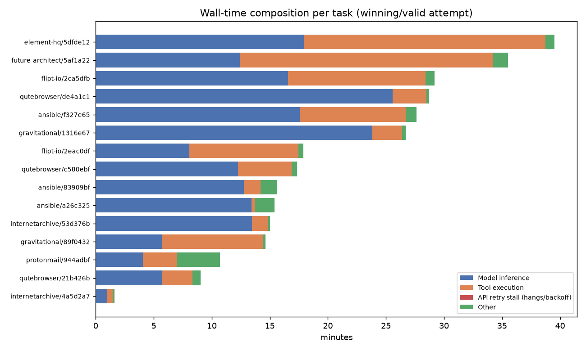
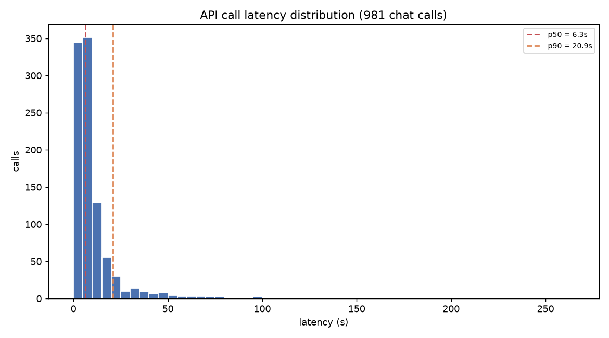

# CS2680 Assignment 3 运行报告 · Full Run 4

生成日期：2026-11-21 · 统计规则：每题计一次有效尝试（见 §11）

## 1. 概述

- **成绩：11/15（73.3%）**
- 模型：全程 `qwen3.8-flash`（standard 档，reasoning_effort=medium）；expert/starter 配置未启用
- 环境：Windows 16GB 笔记本 + WSL2 Docker VM 12GB，2 并发 × 4g 沙箱，1 并发评分
- 计费：Qwen 目录价等价（¥0.8/M 输入、¥0.1/M 缓存输入、¥2.7/M 输出），非实际现金支出（Token Plan 订阅额度）；美元按 7.1 折算

## 2. Agent 配置与设计

- **参照版本**：git `afa3045`（工作树干净）
- src 指纹（sha256 前 16 位）：`d8eb49885dfa2841`

| 配置项 | 值 |
|---|---|
| MAX_ITERATIONS | `100` |
| MAX_OPEN_TASKS | `2` |
| API_RETRIES | `7` |
| API_BACKOFF_S | `4.0` |
| API_BACKOFF_MAX_S | `60.0` |
| PRESERVE_THINKING | `true` |
| MODEL_EXPERT | `qwen4-max` |
| MODEL_STANDARD | `qwen3.8-flash` |
| MODEL_STARTER | `qwen3.6-flash` |
| MODEL_EXTRA_BODY | `{"qwen4-max": {"reasoning_effort": "high"}, "qwen3.8-flash": {"reasoning_effort": "medium"}, "qwen3.6-flash": {"thinking_budget": 16384}}` |
| TOOL_COMPACT_THRESHOLD | `40000` |
| ARCHIVE_HYSTERESIS_TOKENS | `8000` |
| WINDOW_TOKEN_BUDGET | `8000` |
| BASH_INSERT_MIN_CHARS | `2000` |
| SUMMARY_COMPACT_THRESHOLD | `56000` |

**架构（三层）**

- 宿主调度器 `evaluation_scripts/run_all.py`：任务分配、沙箱生命周期、评分调度（不属于提交单元）。
- agent 容器 `src/`：ReAct 主循环，唯一提交单元；本报告的性能对比均以 `src/` 的版本为准。
- 每任务一个 Docker 沙箱（`sandbox_server.py` 提供文件/shell 操作，4g 内存上限）+ 独立评分容器（官方 verifier，断网）。

**主循环（agentic_loop.py）**

- ThreadPoolExecutor 并行，`MAX_OPEN_TASKS` 个 worker；每任务至多 `MAX_ITERATIONS` 轮。
- 每 `MAX_ITERATIONS/25` 轮注入进度提醒（PROGRESS_REMINDER）；同一文件读取达 3 次注入重复读取提醒。
- 任务异常隔离：单任务崩溃不影响其余任务；`solve()` 的 finally 提取并提交已有 diff（rescue submit）。

**模型调用**

- 单一档位 `MODEL_STANDARD`；`MODEL_EXTRA_BODY` 按模型注入 reasoning_effort 或 thinking_budget（二者互斥）。
- `PRESERVE_THINKING=1`：reasoning_content 回写 assistant 历史（Qwen preserve_thinking）。
- 瞬时故障重试 7 次指数退避（4s→60s），覆盖 408/409/429/5xx。
- 历史净化：畸形 `function.arguments` 在历史副本中归一为 `"{}"`（`_valid_arguments`），执行路径保留原始错误反馈给模型。

**上下文管理（memory.py，两层压缩 · V6 重设计）**

- 层 1 批量归档：prompt_tokens ≥ 40K 且距上次归档增长 ≥ 8K 才触发；活窗口 = 尾部累计 ≤ 8K token 的工具输出（无条数约束）；原始 ≥ 2× 预览（1200 字符）才归档为 600 字符预览（头 100/尾 500）+ 引用；水位线以下永不改写——两次批量之间请求前缀逐字节稳定，最大化前缀缓存命中。
- bash 出生即预览：≥ 2000 字符的 bash 输出在插入时即归档（头 100/尾 900，全文可 `read_archived_output` 按行取回），此后永不改写；trace 仍记全文。
- 层 2（≥ 56K）：全量摘要 compaction，历史替换为 system + 摘要 + 当前计划 + git status/diff 快照 + **结构化状态块**（已读/已改文件、scratch、最近命令、归档索引），压缩后取回通路不断头。

**工具集（7 个）**：read_file、read_archived_output、search（字面匹配）、edit_file、create_file、bash（拒绝 cat/sed/head/tail）、update_plan；scratch 文件限定 /work，避免污染补丁。

**系统提示词（prompts.py）**：预算、自主性、ground-truth（否定可靠记忆、防 PR-recall 螺旋）、行动偏向、工具纪律、验证六段；参考 openai/codex 编码提示词重写。

**追踪**：每任务 latency.jsonl（逐调用模型/延迟/token/缓存）+ run.jsonl（api_request/tool_call/tool_result/run_end）。

## 3. 版本变更

本轮：git `afa3045`，指纹 `d8eb49885dfa2841`。

**相对 Full Run 3**（git `3217cd8`，指纹 `9f11234ff2055239`）：代码有变更（行为级）。
提交：
```
e1cd0e6 feat(a3): per-hunk edit results + git-discipline and replace_all prompt rules
afa3045 feat(a3): read_file source pagination and atomic batch edit with replace_all
```

文件变更：
```
assignment3/starter_code/src/agentic_loop.py   |  9 ++-
 assignment3/starter_code/src/config.py         |  4 ++
 assignment3/starter_code/src/memory.py         | 11 ++-
 assignment3/starter_code/src/prompts.py        | 22 ++++--
 assignment3/starter_code/src/sandbox.py        |  5 +-
 assignment3/starter_code/src/sandbox_server.py | 95 ++++++++++++++++++++------
 assignment3/starter_code/src/tools.py          | 43 +++++++++---
 7 files changed, 149 insertions(+), 40 deletions(-)
```


**相对 Full Run 1**（git `a731a16`，指纹 `3da72e34d286f470`）：代码有变更（行为级）。
提交：
```
e1cd0e6 feat(a3): per-hunk edit results + git-discipline and replace_all prompt rules
afa3045 feat(a3): read_file source pagination and atomic batch edit with replace_all
68c363f feat(a3): batch compaction with prefix-cache stability, unified config, tools/reports layout
```

文件变更：
```
assignment3/starter_code/src/agentic_loop.py   |  43 ++-
 assignment3/starter_code/src/config.py         |  98 ++++--
 assignment3/starter_code/src/memory.py         | 420 +++++++++++++++----------
 assignment3/starter_code/src/prompts.py        | 201 ++++++------
 assignment3/starter_code/src/sandbox.py        |   5 +-
 assignment3/starter_code/src/sandbox_server.py |  95 ++++--
 assignment3/starter_code/src/tools.py          |  43 ++-
 7 files changed, 583 insertions(+), 322 deletions(-)
```


## 4. 性能对比

仅对比两轮共同题目；Δ = (本轮 − 参照) / 参照。无行为级变更的参照不做性能对比（差异仅为采样噪声）。

### 相对 Full Run 3

| 题目 | 结果 参→本 | 墙钟 min 参→本 | Δ墙钟 | 花费 ¥ 参→本 | Δ花费 |
|---|---|---|---:|---|---:|
| ansible/a26c325 | FAIL→PASS | 14.3→14.1 | -2% | 0.395→0.556 | +41% |
| ansible/f327e65 | PASS→PASS | 14.4→11.2 | -22% | 0.192→0.199 | +3% |
| flipt-io/2ca5dfb | PASS→PASS | 38.1→26.9 | -30% | 0.520→0.672 | +29% |
| flipt-io/2eac0df | PASS→PASS | 21.1→10.0 | -53% | 0.383→0.105 | -73% |
| future-architect/5af1a22 | PASS→PASS | 39.3→28.8 | -27% | 0.447→0.411 | -8% |
| gravitational/1316e67 | PASS→PASS | 29.6→32.4 | +10% | 0.586→0.875 | +49% |
| gravitational/89f0432 | PASS→PASS | 26.7→10.7 | -60% | 0.489→0.157 | -68% |
| internetarchive/4a5d2a7 | PASS→PASS | 1.9→3.7 | +98% | 0.036→0.088 | +144% |
| internetarchive/53d376b | PASS→PASS | 18.1→22.1 | +22% | 0.403→0.683 | +70% |
| qutebrowser/21b426b | FAIL→PASS | 10.9→8.1 | -26% | 0.238→0.215 | -10% |
| qutebrowser/de4a1c1 | PASS→PASS | 26.6→27.2 | +2% | 0.663→0.678 | +2% |
| ansible/83909bf | FAIL→FAIL | 16.3→15.0 | -8% | 0.370→0.518 | +40% |
| element-hq/5dfde12 | PASS→FAIL | 39.6→23.4 | -41% | 0.764→0.521 | -32% |
| protonmail/944adbf | PASS→FAIL | 9.7→8.6 | -11% | 0.041→0.052 | +28% |
| qutebrowser/c580ebf | PASS→FAIL | 32.5→39.0 | +20% | 0.586→0.403 | -31% |

**汇总对比（仅共同题目，相对 Full Run 3）**：

| 指标 | Full Run 3 | 本轮 | Δ |
|---|---:|---:|---:|
| 解题数 | 12/15 | 11/15 | -1 |
| 花费 ¥ | 6.11 | 6.13 | +0% |
| 平均解题时间 min | 24.8 | 17.7 | -28% |
| $/solved | 0.072 | 0.079 | +9% |

共同题目中 9 题明显更快（墙钟降幅 >5%），4 题明显更慢。
### 相对 Full Run 1

| 题目 | 结果 参→本 | 墙钟 min 参→本 | Δ墙钟 | 花费 ¥ 参→本 | Δ花费 |
|---|---|---|---:|---|---:|
| ansible/a26c325 | PASS→PASS | 16.8→14.1 | -16% | 0.594→0.556 | -6% |
| ansible/f327e65 | PASS→PASS | 60.6→11.2 | -82% | 0.724→0.199 | -73% |
| flipt-io/2ca5dfb | PASS→PASS | 31.1→26.9 | -14% | 0.768→0.672 | -13% |
| flipt-io/2eac0df | PASS→PASS | 11.2→10.0 | -10% | 0.113→0.105 | -7% |
| future-architect/5af1a22 | PASS→PASS | 24.3→28.8 | +18% | 0.205→0.411 | +100% |
| gravitational/1316e67 | PASS→PASS | 33.7→32.4 | -4% | 1.098→0.875 | -20% |
| gravitational/89f0432 | PASS→PASS | 18.2→10.7 | -41% | 0.399→0.157 | -61% |
| internetarchive/4a5d2a7 | PASS→PASS | 5.9→3.7 | -38% | 0.157→0.088 | -44% |
| internetarchive/53d376b | PASS→PASS | 20.7→22.1 | +7% | 0.712→0.683 | -4% |
| qutebrowser/21b426b | FAIL→PASS | 6.8→8.1 | +20% | 0.117→0.215 | +83% |
| qutebrowser/de4a1c1 | PASS→PASS | 25.5→27.2 | +7% | 0.733→0.678 | -7% |
| ansible/83909bf | FAIL→FAIL | 16.8→15.0 | -11% | 0.657→0.518 | -21% |
| element-hq/5dfde12 | PASS→FAIL | 45.0→23.4 | -48% | 0.916→0.521 | -43% |
| protonmail/944adbf | PASS→FAIL | 7.8→8.6 | +11% | 0.061→0.052 | -15% |
| qutebrowser/c580ebf | PASS→FAIL | 20.0→39.0 | +96% | 0.385→0.403 | +5% |

**汇总对比（仅共同题目，相对 Full Run 1）**：

| 指标 | Full Run 1 | 本轮 | Δ |
|---|---:|---:|---:|
| 解题数 | 13/15 | 11/15 | -2 |
| 花费 ¥ | 7.64 | 6.13 | -20% |
| 平均解题时间 min | 24.7 | 17.7 | -28% |
| $/solved | 0.083 | 0.079 | -5% |

共同题目中 8 题明显更快（墙钟降幅 >5%），6 题明显更慢。

任务集不同时解题数不可直接比。

## 5. 总结与反思

本节回答：**本轮改动（#4 read_file 源头分页 + #1 原子批量编辑）对 agent 表现有没有提升**。

**1. 成本与时延：中性（无退化，也未见新收益）**

- 总成本 ¥6.13（run3 ¥6.11，持平），缓存命中 91.1%（run3 91.7%，持平）。成本红利已被 V6 压缩吃掉，编辑/读取工具改造在 token 层不是大头——编辑调用本身很便宜。

**2. 解题能力：净 −1，但构成变化比总数更重要**

- 新拿下：qutebrowser/21b426b（**历史首次通过**，0/28）、ansible/a26c325（回归修复）；新失：ansible/83909bfa（**0 字节补丁**，非题面失败）、webclients/944adbf（真实导入 bug）、element-web、c580ebf（字符串近失）。
- 关键修正：V7 判定 21b426b 的 repr 偏差"确定性、零反馈不可修复"——本轮被推翻，第四次尝试写出 gold 的 `vmap=odict_values([...])` 格式并通过。但子代理证据显示真因是**模型从任务给出的 commit 线索推断出预期 repr**，而非 V7 猜测的"工具改动翻转确定性决策"。教训：把单次行为变化归因于机制改动前，必须查 thinking 证据；"确定性"结论本身也只是 3 样本的小样本推断。

**3. 新机制采纳情况（这才是本轮真正要测的）**

- 批量编辑被**充分采纳**：133 次 edit_file 调用承载约 300 个真实 hunk，72 次为多 hunk 调用；flipt/2eac0df 用 3 个大批（8+8+7 文件）一次完成接口重命名全库清扫，teleport/89f0432 两个 7/6 文件批零失败完成 ioutil→io——批量原子接口在机械替换上收益最大。
- 原子校验的**防呆价值**被一次事故验证：teleport/1316e67 有次调用模型把 `files` 双重编码成 JSON 字符串，工具逐字符拆出 4413 个"伪 hunk"，原子校验整批拒绝（status=error），下一轮以正确结构重试成功——若沿用旧的逐个 edit 语义，这场事故会静默写坏文件。
- `replace_all` 仅用 1 次：模型仍倾向把同一 token 的重复替换拆成多个 hunk 或用 replace_all 之外的写法；引导可加强。
- read_file 分页：281 次读取中 **201 次带显式 start_line、202 次带 end_line，90 次触发分页提示并往后翻页**——机制被自然吸收。ansible/a26c325 的 2000+ 行 urls.py 全靠逐页扫描（该任务本轮恢复通过）。

**4. 新暴露的通用失败模式**

- 83909bfa 的 0 字节补丁：模型收尾 `git add -A` 把改动暂存，harness 的 `git add -N . && git diff` 只抓未暂存 → 空补丁。模型在 thinking 里已意识到"我 staged 了"却判断"留着无妨"——是习惯与提取机制的交互 bug，修法是提示词纪律（勿 stage/stash/commit）。

**结论**：批量编辑与 read 分页**双双被充分采纳且未见副作用**，是本轮最确定的正向信号；批量原子校验还拦截了一次双重编码事故（防呆红利）。意外收获是 21b426b 首次通过——但子代理证据显示它靠的是任务给出的 commit 线索推断出 gold repr 格式，**不是** V7 猜测的"工具改动翻转确定性决策"，需据此修正 V7 结论。单轮 11/15 的下滑主要来自 83909bfa 的 git-add 0 字节与 webclients 接口细节，均属可修的通用工程项，非新工具退化。

## 6. 逐题结果

| 题目 | 结果 | 轮数 | 墙钟 min | 模型 min | 输入 M | 输出 K | 缓存% | 花费 ¥ |
|---|---|---:|---:|---:|---:|---:|---:|---:|
| ansible/a26c325 | PASS | 89 | 14.1 | 11.6 | 2.93 | 33.9 | 91.6 | 0.556 |
| ansible/f327e65 | PASS | 40 | 11.2 | 7.7 | 0.97 | 23.1 | 94.2 | 0.199 |
| flipt-io/2ca5dfb | PASS | 98 | 26.9 | 15.9 | 3.13 | 52.2 | 90.0 | 0.672 |
| flipt-io/2eac0df | PASS | 25 | 10.0 | 2.0 | 0.50 | 9.4 | 91.7 | 0.105 |
| future-architect/5af1a22 | PASS | 44 | 28.8 | 11.6 | 1.29 | 43.1 | 81.7 | 0.411 |
| gravitational/1316e67 | PASS | 87 | 32.4 | 29.8 | 2.62 | 105.8 | 82.1 | 0.875 |
| gravitational/89f0432 | PASS | 36 | 10.7 | 4.7 | 0.79 | 16.7 | 94.0 | 0.157 |
| internetarchive/4a5d2a7 | PASS | 29 | 3.7 | 2.7 | 0.42 | 8.0 | 91.7 | 0.088 |
| internetarchive/53d376b | PASS | 74 | 22.1 | 20.8 | 2.38 | 80.1 | 86.3 | 0.683 |
| qutebrowser/21b426b | PASS | 43 | 8.1 | 5.2 | 1.07 | 16.6 | 91.7 | 0.215 |
| qutebrowser/de4a1c1 | PASS | 85 | 27.2 | 20.4 | 2.52 | 73.9 | 87.1 | 0.678 |
| ansible/83909bf | FAIL | 73 | 15.0 | 13.4 | 2.29 | 42.3 | 89.1 | 0.518 |
| element-hq/5dfde12 | FAIL | 82 | 23.4 | 12.6 | 2.61 | 35.7 | 91.1 | 0.521 |
| protonmail/944adbf | FAIL | 24 | 8.6 | 1.9 | 0.21 | 5.1 | 88.5 | 0.052 |
| qutebrowser/c580ebf | FAIL | 63 | 39.0 | 10.7 | 2.16 | 29.2 | 92.9 | 0.403 |

## 7. 汇总指标

| 指标 | 数值 |
|---|---|
| API 调用 | 916 次，平均 11.2 s/次 |
| Token 总量 | 输入 25.90M / 输出 575.1K（45:1），缓存命中 89.0% |
| 平均解题时间 | **17.7 min**（中位 14.1；最快 3.7，最慢 32.4） |
| 任务墙钟总和 | 4.69 h（2 并发，实际历时更短）；模型推理 2.85 h，占 61% |
| **总花费（目录价等价）** | **¥6.13 ≈ $0.86** |
| 成本构成 | 未缓存输入 ¥2.27（37%）+ 缓存输入 ¥2.31（38%）+ 输出 ¥1.55（25%） |
| 平均每题花费 | ¥0.41 |
| 平均每个胜题花费 | ¥0.56 ≈ **$0.079/solved** |
| 胜题单次成本 | 最低 ¥0.09，最高 ¥0.87 |

compaction 调用未记录 usage，成本低估可忽略。


## 8. Agent 行为分析

数据源：run.jsonl 的 tool_call/tool_result 事件；思维链总结基于 agent.log 的 [thinking] 记录（run5 缺失，据工具序列重建）。重复浪费 = 工具名与参数完全相同的多余调用次数；高频重读 = 同一文件以不同行段反复读取。

| 题目 | 工具分布 | 首编辑轮 | 编辑次数 | 测试命令 | 重复浪费 | 错误结果 |
|---|---|---:|---:|---:|---:|---:|
| ansible/a26c325 | bash50 read35 edit13 create5 plan3 | 17 | 18 | 13 | 0 | 7/110 |
| ansible/f327e65 | bash32 read6 edit5 search3 plan3 | 14 | 6 | 10 | 0 | 2/51 |
| flipt-io/2ca5dfb | bash57 read36 search17 edit11 create3 | 38 | 14 | 11 | 4 | 4/127 |
| flipt-io/2eac0df | bash10 read10 edit6 search3 plan3 | 9 | 6 | 5 | 0 | 3/34 |
| future-architect/5af1a22 | bash27 read18 edit6 plan3 create2 | 14 | 8 | 5 | 0 | 3/58 |
| gravitational/1316e67 | bash33 read31 edit23 search5 plan2 | 14 | 25 | 4 | 1 | 10/96 |
| gravitational/89f0432 | bash24 read17 edit6 plan3 search1 | 8 | 6 | 5 | 0 | 0/51 |
| internetarchive/4a5d2a7 | bash17 read6 search4 plan2 edit2 | 5 | 4 | 9 | 0 | 1/34 |
| internetarchive/53d376b | bash52 read25 edit10 search3 plan2 | 22 | 11 | 10 | 1 | 3/93 |
| qutebrowser/21b426b | bash32 archive6 read5 search2 edit2 | 17 | 3 | 15 | 0 | 1/50 |
| qutebrowser/de4a1c1 | bash62 edit17 read12 search4 plan3 | 16 | 19 | 26 | 0 | 8/103 |
| ansible/83909bf | bash46 read26 edit13 search3 plan3 | 26 | 14 | 9 | 0 | 4/95 |
| element-hq/5dfde12 | bash37 read37 search13 edit9 plan4 | 5 | 11 | 12 | 0 | 4/102 |
| protonmail/944adbf | bash13 read5 plan2 create2 edit2 | 9 | 4 | 6 | 0 | 0/26 |
| qutebrowser/c580ebf | bash42 read12 edit8 plan3 search2 | 10 | 8 | 32 | 1 | 4/68 |

**动作耗时（全部题目合计）**：

| 工具 | 次数 | 总耗时 min | 平均 s | 最大 s |
|---|---:|---:|---:|---:|
| bash | 534 | 97.5 | 11.0 | 438 |
| search | 63 | 1.9 | 1.8 | 32 |
| read_file | 281 | 0.0 | 0.0 | 0 |
| edit_file | 133 | 0.0 | 0.0 | 0 |
| create_file | 24 | 0.0 | 0.0 | 0 |
| read_archived_output | 22 | 0.0 | 0.0 | 0 |
| update_plan | 40 | 0.0 | 0.0 | 0 |
| grep | 1 | 0.0 | 0.0 | 0 |

**压缩发生（层 1 工具归档 / 层 2 摘要压缩）**：

| 题目 | 层1 次数 | 层1 发生分布 | 层2 次数 | 层2 发生轮 |
|---|---:|---|---:|---|
| ansible/a26c325 | 2 | turn 29（×12），turn 55（×6） | 1 | turn 75 |
| ansible/f327e65 | 0 | 无 | 0 | 无 |
| flipt-io/2ca5dfb | 3 | turn 22（×10），turn 38（×3），turn 89（×4） | 1 | turn 47 |
| flipt-io/2eac0df | 0 | 无 | 0 | 无 |
| future-architect/5af1a22 | 2 | turn 15（×4），turn 24（×3） | 1 | turn 32 |
| gravitational/1316e67 | 4 | turn 15（×2），turn 18（×2），turn 40（×2），turn 50（×2） | 2 | turn 19、turn 60 |
| gravitational/89f0432 | 0 | 无 | 0 | 无 |
| internetarchive/4a5d2a7 | 0 | 无 | 0 | 无 |
| internetarchive/53d376b | 3 | turn 30（×8），turn 38（×4），turn 66（×1） | 1 | turn 40 |
| qutebrowser/21b426b | 1 | turn 42（×9） | 0 | 无 |
| qutebrowser/de4a1c1 | 4 | turn 21（×9），turn 33（×1），turn 75（×1），turn 85（×2） | 1 | turn 37 |
| ansible/83909bf | 2 | turn 23（×7），turn 42（×4） | 1 | turn 56 |
| element-hq/5dfde12 | 2 | turn 35（×14），turn 52（×12） | 1 | turn 72 |
| protonmail/944adbf | 0 | 无 | 0 | 无 |
| qutebrowser/c580ebf | 2 | turn 31（×6），turn 53（×4） | 0 | 无 |

层 1：≥40K 且距上次归档 ≥8K 触发；窗口 = 尾部 ≤8K token；原始 ≥1200 字符才归档；bash ≥2000 字符出生即预览（不计入层 1 事件）；层 2 ≥56K（config.py）。层 1 计数依赖 agent.log；层 2 来自 latency.jsonl。




**自动标记**：

- ansible/a26c325：首编辑迟至第 17 轮；高频重读 urls.py ×12（不同行段）
- flipt-io/2ca5dfb：首编辑迟至第 38 轮；高频重读 config.go ×7（不同行段）
- gravitational/1316e67：高频重读 dynamoevents.go ×26（不同行段）
- internetarchive/53d376b：首编辑迟至第 22 轮；高频重读 load_book.py ×8（不同行段）
- qutebrowser/21b426b：首编辑迟至第 17 轮
- qutebrowser/de4a1c1：首编辑迟至第 16 轮
- ansible/83909bf：首编辑迟至第 26 轮；高频重读 galaxy.py ×11（不同行段）
- element-hq/5dfde12：高频重读 useOwnDevices.ts ×7（不同行段）

**逐题行为与思维链总结**：

### ansible/a26c325

89 轮，urls.py 超 2000 行，35 次读取全部带 start_line 逐页扫（1230→2015 行），分页是该大文件任务的生命线。本轮恢复通过的关键正是签名位置：模型显式对齐参考提交，把 use_netrc 追加到 open_url/fetch_url/url_get/uri 参数表末尾并关键字透传，修复了 run3 的错位。自建 scratch 验证参数线连通后删除；3 次批失败（缩进不一致）靠重读精确行解决。

### ansible/f327e65

40 轮，turn 13–16 连续 4 个大批（3/3/4/4 文件）一次写完 collection 名称校验，turn 23 起以测试验证为主；用 git stash 证明失败为环境预存在，并主动撤掉自己编造的 changelog issue 链接（诚实度亮点）。6 次读取全带分页，开销极小。

### flipt-io/2ca5dfb

98 轮长跑，search 17 次占前 37 轮、首编辑 turn 38。大量多文件批编辑（turn 65/66 各 4 文件、75/76 各 3 文件），23 个 hunk 分摊在 11 次调用；3 次批失败后降级为单 hunk 重试成功。读取分页 10 次全部正确续读，无重复整读浪费；缺点是测试验证轮次偏多。

### flipt-io/2eac0df

25 轮速胜，turn 9–11 用 3 个大批（8+8+7 文件）完成接口重命名的全库清扫——新批量 edit_file 最教科书式的使用；批内任一 hunk 不匹配则整批不写，随后 2 次单文件小补到位。10 次读取 6 次分页、3 次触发提示并续读。

### future-architect/5af1a22

44 轮高效样本：turn 3 即定位目标文件，turn 13–29 用 6 次编辑（含 2 次双文件批）集中落改动，18 次读取 14 次带 start_line 分页、6 次续读。原子批在此避免了 2 次部分匹配导致的半写。

### gravitational/1316e67

87 轮，改动集中在 dynamoevents.go 的事件存储逻辑。turn 37 出现"4413 hunks"调用——实为模型把 files 参数双重编码成字符串、工具逐字符拆成伪 hunk，原子校验整批拒绝，turn 38 以正确结构单 hunk 重试成功：一次序列化事故反而验证了批校验的防呆。全程 23 次编辑 10 次失败（空 path、old==new 空操作、空白不匹配），每次都能定位原因并缩小批次，自纠错强但试错成本偏高。

### gravitational/89f0432

36 轮，ioutil→io 清扫在 turn 14–15 用两个 7/6 文件批一次完成、17 个 hunk 零失败——批量原子接口在机械替换上收益最大的样例。17 次读取全部带 start_line（逐页扫大文件），无重复读。

### internetarchive/4a5d2a7

29 轮最简任务：turn 4 一个双文件批 + turn 14 一次单 hunk 即完成，编辑零失败。6 次读取仅 3 次带分页，工具使用克制，主要时间花在测试确认。

### internetarchive/53d376b

74 轮，前 20 轮探索、turn 21–24 首次批量编辑，之后"编辑→测试→再编辑"直至完成。25 次 read_file 中 24 次带显式 start_line、6 次触发分页提示并按提示续读——分页机制被自然吸收。10 次 edit_file 有 3 次失败（含一次跨 3 文件批），原子校验拒绝后回读原文再单独重试，行为稳健。

### qutebrowser/21b426b

43 轮，历史首次通过。模型 turn 15 从任务给出的 commit 线索推断出预期 repr 为 `vmap=odict_values([...])`，turn 17 用一个 10-hunk 批把 _values 列表整体换成 OrderedDict 的 _vmap，`get_repr(..., vmap=self._vmap.values())` 在 Python 3.11 下恰好产出 odict_values 字面量、与 hidden 测试吻合；turn 22 再 3-hunk 批同步可见测试与白名单。两次批编辑零失败，5 次读取完成侦察——机制红利最大化的样例。

### qutebrowser/de4a1c1

85 轮，bash 62 次、验证密集。17 次编辑仅 11 次成功、6 次被原子校验拒绝（空白/上下文不匹配），但每次失败信息都促使回读精确行区间再重试，未盲改。多 hunk 批 7 次，覆盖 config 相关 2–3 文件联动。

### ansible/83909bf

73 轮，删除 galaxy login 特性，13 次编辑中 4 次被原子拒绝后均恢复，工作本身合格。灾难在收尾：turn 70–71 为区分预存在失败做了 git stash -u/pop，turn 72 为做最终 diff 审查执行 `git add -A`，turn 74 thinking 已意识到"我 staged 了"却判断"留着无妨"；harness 用 `git add -N . && git diff`（未暂存）提取补丁，暂存内容不被捕获 → 0 字节补丁、150/150 全挂。git 自检习惯整体是优点，唯独最后一次 add -A 成致命单点。

### element-hq/5dfde12

82 轮，双特性任务（客户端信息 + 语音广播错误弹窗）。自建临时测试验证弹窗参数、其自身两断言失败后 turn 76 判定为环境伪影并删除——但 grading 仍剩 1 个失败，疑点落在 description 用 `<p>{_t(...)}</p>` 包裹的参数形状。亮点：对 5 个 last_chunk_sequence 旧行为失败明确判断"将由 hidden test 替换"而未迁就改测试。

### protonmail/944adbf

24 轮，新建 observeApiError.ts + 自写测试、本地 jest 全绿后收工。致命点是**功能放错仓库位置**：隐藏 gold 测试在仓库根 `tests/observeApiError.test.ts`，模型却把实现与自测都放进子包 `packages/metrics/`；根 jest 工程加载该 TS 报 `Module parse failed: Unexpected token (11:17)` → 0 测试收集 → 10/10 全挂。属代码库结构误判（在错误子项目解题），与批量/分页机制无关；小文件低覆盖任务对新机制依赖不大。

### qutebrowser/c580ebf

63 轮，实现子域名加宽屏蔽。关键败笔 turn 16–17：既有测试 test_disabled_blocking_per_url 依赖 QUrl host 为空的怪癖，新语义使其失败，模型选择改可见测试顺从实现（thinking 中纠结"不应改测试"），hidden 测试仍以 1 个失败否决该语义取舍。批量编辑正常（3 次多 hunk 批、2 次空 path 失败后重试）。


## 9. Token 用量分析

1. **输入:输出 = 45:1**：agent 负载的成本主体是反复提交上下文，而非生成。89% 的缓存命中节省约 ¥16.1；若无前缀缓存，总成本约为 ¥22.3。前缀缓存是该 harness 中价值最高的机制，compaction 策略（减少触发、触发后保持前缀稳定）直接决定成本。
2. **输出仅占 token 的 2.2%，却占成本 25%**；未缓存输入占 token 11%、占成本 37%。压缩成本的两个杠杆：减少上下文失效、控制输出长度。reasoning_effort=medium 下平均输出 628 tok/call、平均延迟 11.2 s。



## 10. 失败案例分析

本轮 11/15，四道未过，其中两类是新情况：

### 10.1 ansible/83909bfa —— 0 字节补丁（非题面失败，是收尾 git 操作与提取机制冲突）

- 评分 150/150 全挂、耗时 0s，是 0 字节补丁的签名；补丁文件确认 0 字节。
- 根因：模型收尾 it71 跑了 `git add -A` 自查改动，把全部改动暂存进 index；课程提取是 `git add -N . && git diff`（只反映未暂存改动）→ 抓空。此前 it61/it70 还多次 `git stash` 做基线对比。
- 定性：这是模型用 git 自查的习惯 × harness 只抓未暂存改动的交互失败，不是能力或题面问题（run3 同题未踩是因那次收尾没 `git add`）。通用修法：提示词纪律"编辑留在工作区，勿 git add/stash/commit，harness 自取未暂存改动"。

### 10.2 webclients/944adbf —— 10/10 全挂（功能放错仓库位置，非导出形式）

- 补丁 4.4KB 非空。隐藏 gold 测试位于**仓库根 `tests/observeApiError.test.ts`**，而模型把实现与自测都放进子包 `packages/metrics/`。
- 评分时根 jest 工程加载该 `.ts` 报 `Module parse failed: Unexpected token (11:17)`（`export type`、`error: any` 等 TS 语法在根工程 babel 配置下未转译）→ 0 个测试被收集 → 10 个 gold 测试全记 missing/失败。模型在 `packages/metrics/tests/` 自建的测试本地全绿，但评分跑的不是那个路径。
- 定性：**代码库结构误判（在错误的子项目里解题）**，与批量编辑/分页机制无关；run1/run3 同题曾一次通过，属随机回归。

### 10.3 element-web/5dfde12 (1/61)、qutebrowser/c580ebf (1/202) —— 精确字符串近失

- 各差 1 个必过测试，与 Full Run 1 失败案例分析中的规格歧义 × 精确匹配同构；本轮上下文/工具变化后硬币落到另一面。

## 11. 统计方法说明

- **每题计一次有效尝试**：通过题取首次通过的尝试；未通过题取最后一次有效评分（官方 verifier 链路）。因崩溃、OOM、编排器故障、verifier 缺陷或模型行为异常而无效的尝试不计入时间与成本。
- 尝试按 hostlog 运行 ID 分组，本报告只含本轮尝试。
- 耗时 = trace 首末事件时间差；成本按目录价逐调用累加；compaction 调用无 usage 记录，未计入。
- 任务归属按 hostlogs 任务表快照 + trace 位置序号对齐；无 results.md 的轮次以 evaluations.tsv 补充判定。
- 排行榜数据取自截止后的静态 API（作业已关闭，无新增提交）。
