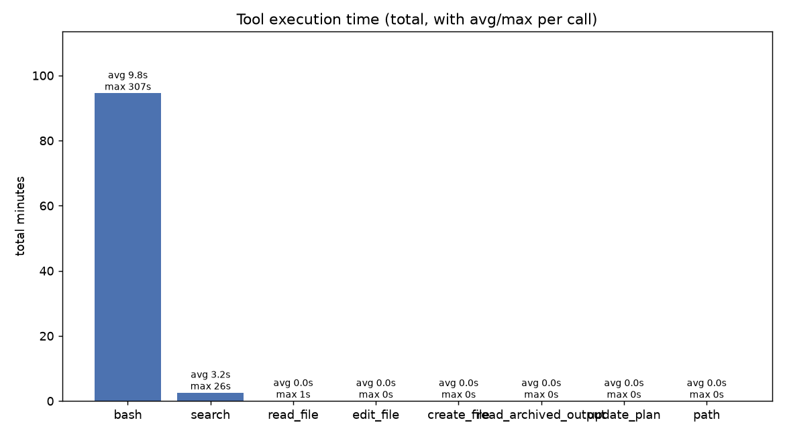

# CS2680 Assignment 3 运行报告 · Full Run 7

生成日期：2026-11-21 · 统计规则：每题计一次有效尝试（见 §11）

## 1. 概述

- **成绩：12/15（80.0%）**
- 模型：全程 `qwen3.8-flash`（standard 档，reasoning_effort=medium）；expert/starter 配置未启用
- 环境：Windows 16GB 笔记本 + WSL2 Docker VM 12GB，2 并发 × 4g 沙箱，1 并发评分
- 计费：Qwen 目录价等价（¥0.8/M 输入、¥0.1/M 缓存输入、¥2.7/M 输出），非实际现金支出（Token Plan 订阅额度）；美元按 7.1 折算

## 2. Agent 配置与设计

- **参照版本**：git `b3ce89b`（工作树干净）
- src 指纹（sha256 前 16 位）：`40000ee74aa45e01`

| 配置项 | 值 |
|---|---|
| MAX_ITERATIONS | `100` |
| MAX_OPEN_TASKS | `2` |
| API_RETRIES | `7` |
| API_BACKOFF_S | `4.0` |
| API_BACKOFF_MAX_S | `60.0` |
| PRESERVE_THINKING | `true` |
| MODEL_EXPERT | `qwen4-max` |
| MODEL_STANDARD | `qwen3.8-flash` |
| MODEL_STARTER | `qwen3.6-flash` |
| MODEL_EXTRA_BODY | `{"qwen4-max": {"reasoning_effort": "high"}, "qwen3.8-flash": {"reasoning_effort": "medium"}, "qwen3.6-flash": {"thinking_budget": 16384}}` |
| TOOL_COMPACT_THRESHOLD | `40000` |
| ARCHIVE_HYSTERESIS_TOKENS | `8000` |
| WINDOW_TOKEN_BUDGET | `8000` |
| BASH_INSERT_MIN_CHARS | `2000` |
| SUMMARY_COMPACT_THRESHOLD | `56000` |

**架构（三层）**

- 宿主调度器 `evaluation_scripts/run_all.py`：任务分配、沙箱生命周期、评分调度（不属于提交单元）。
- agent 容器 `src/`：ReAct 主循环，唯一提交单元；本报告的性能对比均以 `src/` 的版本为准。
- 每任务一个 Docker 沙箱（`sandbox_server.py` 提供文件/shell 操作，4g 内存上限）+ 独立评分容器（官方 verifier，断网）。

**主循环（agentic_loop.py）**

- ThreadPoolExecutor 并行，`MAX_OPEN_TASKS` 个 worker；每任务至多 `MAX_ITERATIONS` 轮。
- 每 `MAX_ITERATIONS/25` 轮注入进度提醒（PROGRESS_REMINDER）；同一文件读取达 3 次注入重复读取提醒。
- 任务异常隔离：单任务崩溃不影响其余任务；`solve()` 的 finally 提取并提交已有 diff（rescue submit）。

**模型调用**

- 单一档位 `MODEL_STANDARD`；`MODEL_EXTRA_BODY` 按模型注入 reasoning_effort 或 thinking_budget（二者互斥）。
- `PRESERVE_THINKING=1`：reasoning_content 回写 assistant 历史（Qwen preserve_thinking）。
- 瞬时故障重试 7 次指数退避（4s→60s），覆盖 408/409/429/5xx。
- 历史净化：畸形 `function.arguments` 在历史副本中归一为 `"{}"`（`_valid_arguments`），执行路径保留原始错误反馈给模型。

**上下文管理（memory.py，两层压缩 · V6 重设计）**

- 层 1 批量归档：prompt_tokens ≥ 40K 且距上次归档增长 ≥ 8K 才触发；活窗口 = 尾部累计 ≤ 8K token 的工具输出（无条数约束）；原始 ≥ 2× 预览（1200 字符）才归档为 600 字符预览（头 100/尾 500）+ 引用；水位线以下永不改写——两次批量之间请求前缀逐字节稳定，最大化前缀缓存命中。
- bash 出生即预览：≥ 2000 字符的 bash 输出在插入时即归档（头 100/尾 900，全文可 `read_archived_output` 按行取回），此后永不改写；trace 仍记全文。
- 层 2（≥ 56K）：全量摘要 compaction，历史替换为 system + 摘要 + 当前计划 + git status/diff 快照 + **结构化状态块**（已读/已改文件、scratch、最近命令、归档索引），压缩后取回通路不断头。

**工具集（7 个）**：read_file、read_archived_output、search（字面匹配）、edit_file、create_file、bash（拒绝 cat/sed/head/tail）、update_plan；scratch 文件限定 /work，避免污染补丁。

**系统提示词（prompts.py）**：预算、自主性、ground-truth（否定可靠记忆、防 PR-recall 螺旋）、行动偏向、工具纪律、验证六段；参考 openai/codex 编码提示词重写。

**追踪**：每任务 latency.jsonl（逐调用模型/延迟/token/缓存）+ run.jsonl（api_request/tool_call/tool_result/run_end）。

## 3. 版本变更

本轮：git `b3ce89b`，指纹 `40000ee74aa45e01`。

**相对 Full Run 6**（git `40fd5f2`，指纹 `c31c4da0f6a02268`）：代码有变更（行为级）。
提交：
```
b3ce89b feat(a3): parallel read-only tools, phased reminders, compact plan, edit validation, and log/report fixes
```

文件变更：
```
assignment3/starter_code/src/agentic_loop.py   | 117 ++++++++++++++++++-------
 assignment3/starter_code/src/memory.py         |   4 +-
 assignment3/starter_code/src/prompts.py        |  97 ++++++++++++++++----
 assignment3/starter_code/src/sandbox_server.py |  14 ++-
 assignment3/starter_code/src/tools.py          |  34 +++++--
 5 files changed, 206 insertions(+), 60 deletions(-)
```


**相对 Full Run 1**（git `a731a16`，指纹 `3da72e34d286f470`）：代码有变更（行为级）。
提交：
```
b3ce89b feat(a3): parallel read-only tools, phased reminders, compact plan, edit validation, and log/report fixes
e1cd0e6 feat(a3): per-hunk edit results + git-discipline and replace_all prompt rules
afa3045 feat(a3): read_file source pagination and atomic batch edit with replace_all
68c363f feat(a3): batch compaction with prefix-cache stability, unified config, tools/reports layout
```

文件变更：
```
assignment3/starter_code/src/agentic_loop.py   | 160 +++++++---
 assignment3/starter_code/src/config.py         |  98 ++++--
 assignment3/starter_code/src/memory.py         | 420 +++++++++++++++----------
 assignment3/starter_code/src/prompts.py        | 266 ++++++++++------
 assignment3/starter_code/src/sandbox.py        |   5 +-
 assignment3/starter_code/src/sandbox_server.py | 103 ++++--
 assignment3/starter_code/src/tools.py          |  69 +++-
 7 files changed, 764 insertions(+), 357 deletions(-)
```


## 4. 性能对比

仅对比两轮共同题目；Δ = (本轮 − 参照) / 参照。无行为级变更的参照不做性能对比（差异仅为采样噪声）。

### 相对 Full Run 6

| 题目 | 结果 参→本 | 墙钟 min 参→本 | Δ墙钟 | 花费 ¥ 参→本 | Δ花费 |
|---|---|---|---:|---|---:|
| ansible/83909bf | FAIL→PASS | 6.3→19.2 | +203% | 3.541→0.388 | -89% |
| ansible/a26c325 | FAIL→PASS | 6.8→19.8 | +191% | 1.762→0.479 | -73% |
| ansible/f327e65 | FAIL→PASS | 3.7→21.2 | +479% | 1.167→0.451 | -61% |
| flipt-io/2ca5dfb | FAIL→PASS | 25.5→33.7 | +32% | 3.248→0.685 | -79% |
| flipt-io/2eac0df | PASS→PASS | 15.2→16.1 | +6% | 3.689→0.162 | -96% |
| future-architect/5af1a22 | FAIL→PASS | 18.5→38.8 | +110% | 3.951→0.445 | -89% |
| gravitational/1316e67 | FAIL→PASS | 5.2→31.9 | +514% | 2.727→0.807 | -70% |
| internetarchive/4a5d2a7 | PASS→PASS | 1.4→2.1 | +47% | 0.303→0.030 | -90% |
| internetarchive/53d376b | FAIL→PASS | 6.2→26.6 | +330% | 3.438→0.806 | -77% |
| protonmail/944adbf | FAIL→PASS | 6.6→12.4 | +88% | 0.245→0.062 | -75% |
| qutebrowser/c580ebf | PASS→PASS | 11.0→18.7 | +71% | 3.820→0.337 | -91% |
| qutebrowser/de4a1c1 | PASS→PASS | 4.6→22.1 | +378% | 2.156→0.493 | -77% |
| element-hq/5dfde12 | FAIL→FAIL | 12.1→22.9 | +90% | 3.180→0.504 | -84% |
| gravitational/89f0432 | FAIL→FAIL | 9.1→19.0 | +110% | 3.555→0.255 | -93% |
| qutebrowser/21b426b | FAIL→FAIL | 2.7→16.4 | +499% | 0.530→0.199 | -62% |

**汇总对比（仅共同题目，相对 Full Run 6）**：

| 指标 | Full Run 6 | 本轮 | Δ |
|---|---:|---:|---:|
| 解题数 | 4/15 | 12/15 | +8 |
| 花费 ¥ | 37.31 | 6.10 | -84% |
| 平均解题时间 min | 8.1 | 21.9 | +171% |
| $/solved | 1.314 | 0.072 | -95% |

共同题目中 0 题明显更快（墙钟降幅 >5%），15 题明显更慢。
### 相对 Full Run 1

| 题目 | 结果 参→本 | 墙钟 min 参→本 | Δ墙钟 | 花费 ¥ 参→本 | Δ花费 |
|---|---|---|---:|---|---:|
| ansible/83909bf | FAIL→PASS | 16.8→19.2 | +14% | 0.657→0.388 | -41% |
| ansible/a26c325 | PASS→PASS | 16.8→19.8 | +18% | 0.594→0.479 | -19% |
| ansible/f327e65 | PASS→PASS | 60.6→21.2 | -65% | 0.724→0.451 | -38% |
| flipt-io/2ca5dfb | PASS→PASS | 31.1→33.7 | +8% | 0.768→0.685 | -11% |
| flipt-io/2eac0df | PASS→PASS | 11.2→16.1 | +44% | 0.113→0.162 | +44% |
| future-architect/5af1a22 | PASS→PASS | 24.3→38.8 | +59% | 0.205→0.445 | +117% |
| gravitational/1316e67 | PASS→PASS | 33.7→31.9 | -5% | 1.098→0.807 | -26% |
| internetarchive/4a5d2a7 | PASS→PASS | 5.9→2.1 | -65% | 0.157→0.030 | -81% |
| internetarchive/53d376b | PASS→PASS | 20.7→26.6 | +29% | 0.712→0.806 | +13% |
| protonmail/944adbf | PASS→PASS | 7.8→12.4 | +59% | 0.061→0.062 | +1% |
| qutebrowser/c580ebf | PASS→PASS | 20.0→18.7 | -6% | 0.385→0.337 | -13% |
| qutebrowser/de4a1c1 | PASS→PASS | 25.5→22.1 | -13% | 0.733→0.493 | -33% |
| element-hq/5dfde12 | PASS→FAIL | 45.0→22.9 | -49% | 0.916→0.504 | -45% |
| gravitational/89f0432 | PASS→FAIL | 18.2→19.0 | +5% | 0.399→0.255 | -36% |
| qutebrowser/21b426b | FAIL→FAIL | 6.8→16.4 | +142% | 0.117→0.199 | +70% |

**汇总对比（仅共同题目，相对 Full Run 1）**：

| 指标 | Full Run 1 | 本轮 | Δ |
|---|---:|---:|---:|
| 解题数 | 13/15 | 12/15 | -1 |
| 花费 ¥ | 7.64 | 6.10 | -20% |
| 平均解题时间 min | 24.7 | 21.9 | -11% |
| $/solved | 0.083 | 0.072 | -13% |

共同题目中 6 题明显更快（墙钟降幅 >5%），8 题明显更慢。

任务集不同时解题数不可直接比。

## 5. 总结与反思

本节回答：**V11 通用工程改造（并发只读工具、分阶段进度提醒、紧凑 Plan、顶层布局/测试根盘点、公共输出契约最小变更、日志双保险归档）的实际效果**。

**1. 成本与效率：双创历史最优**

- **总花费 ¥6.10（$0.86）与 $/solved $0.072 均刷新全量历史最低**（run5 ¥6.94 / $0.075，run1 ¥7.64 / $0.083）；前缀缓存命中率回升至 **90.1%**（run5 88.5%），API 调用总数从 993 降至 **929（−6.4%）**，总输入/输出同步下降 7–9%。
- **并发只读被充分采纳**：全 run 触发 **62 轮并发只读批次（134 次并发只读调用）**，省下约 72 次 API 往返；`read_file`（364→305）与 `search`（66→48）总量双降，`bash` 总耗时 99.0→94.6 min（单次最大 596→307 s）。平均解题时间 21.9 min（run5 21.4）基本持平，主因是本轮晚高峰上游单次 API 延迟上升 +17.4%（11.5→13.5 s）抵消了并发省下的等待时间。

**2. 定向改造验效：Run 5 两道失败题双双翻盘**

- **顶层布局/测试根盘点立竿见影**：Run 4/5 连续两轮 10/10 全败的 `protonmail/944adbf` 本轮第 4 轮首编、仅 25 轮 / ¥0.062 一次通过（0/10）。
- **公共输出契约最小变更生效**：Run 3/4/5/6 连挂 4 轮的 `ansible/83909bf` 本轮 63 轮 / ¥0.388 全过（0/150）；`git` 纪律连续两轮保持 **0 违纪**。
- **紧凑 Plan + 分阶段提醒平稳**：`update_plan` 从 43 降至 37 次，去重与单焦点提醒各触发 1 次；全 15 题无一题撞 100 轮上限（最高 93 轮），10/15 题在 14 轮内完成首编。
- **观测性补齐生效**：`agent.log`（1.24MB）完整落盘，15 题层 1 归档记录全部恢复完整。

**3. 本轮未通过项与收官发现**

- 单轮 **12/15**：3 题失败分别为 `qutebrowser/21b426b`（1/28 字符串近失，固有方差）、`gravitational/89f0432`（1/1 偶发回归）、`element-hq/5dfde12`（9/61，首编迟至第 51 轮导致改动不完整）。
- **工具接口教训**：即便 schema 明确标注 `minLength: 1`，扁平批接口 `edit_file(files=[{path, ...}])` 仍出现 **18 次**漏写/错放 `path`（模型习惯把 `path` 写在外层或省略后续 hunk 的 `path`）。实验后已将 `edit_file` 收敛为最贴近预训练分布的标准扁平接口 `edit_file(path, old_string, new_string, replace_all)`（多处修改靠同轮多调用完成），作为本作业的最终代码形态提交收官。

## 6. 逐题结果

| 题目 | 结果 | 轮数 | 墙钟 min | 模型 min | 输入 M | 输出 K | 缓存% | 花费 ¥ |
|---|---|---:|---:|---:|---:|---:|---:|---:|
| ansible/83909bf | PASS | 63 | 19.2 | 14.3 | 2.26 | 28.7 | 94.7 | 0.388 |
| ansible/a26c325 | PASS | 73 | 19.8 | 15.5 | 2.26 | 41.7 | 91.1 | 0.479 |
| ansible/f327e65 | PASS | 65 | 21.2 | 16.9 | 2.01 | 46.9 | 91.2 | 0.451 |
| flipt-io/2ca5dfb | PASS | 86 | 33.7 | 22.5 | 2.95 | 64.1 | 89.5 | 0.685 |
| flipt-io/2eac0df | PASS | 40 | 16.1 | 6.3 | 0.91 | 16.2 | 95.8 | 0.162 |
| future-architect/5af1a22 | PASS | 57 | 38.8 | 11.9 | 1.70 | 38.2 | 85.6 | 0.445 |
| gravitational/1316e67 | PASS | 93 | 31.9 | 25.8 | 2.78 | 77.8 | 83.6 | 0.807 |
| internetarchive/4a5d2a7 | PASS | 14 | 2.1 | 1.4 | 0.10 | 3.4 | 84.5 | 0.030 |
| internetarchive/53d376b | PASS | 77 | 26.6 | 25.0 | 2.47 | 90.1 | 81.7 | 0.806 |
| protonmail/944adbf | PASS | 25 | 12.4 | 2.9 | 0.30 | 6.6 | 93.0 | 0.062 |
| qutebrowser/c580ebf | PASS | 53 | 18.7 | 12.4 | 1.93 | 31.0 | 95.6 | 0.337 |
| qutebrowser/de4a1c1 | PASS | 93 | 22.1 | 18.5 | 2.53 | 44.5 | 93.3 | 0.493 |
| element-hq/5dfde12 | FAIL | 69 | 22.9 | 17.4 | 2.06 | 48.6 | 88.4 | 0.504 |
| gravitational/89f0432 | FAIL | 54 | 19.0 | 9.9 | 1.39 | 21.4 | 94.0 | 0.255 |
| qutebrowser/21b426b | FAIL | 42 | 16.4 | 8.4 | 1.16 | 18.6 | 96.0 | 0.199 |

## 7. 汇总指标

| 指标 | 数值 |
|---|---|
| API 调用 | 929 次，平均 13.5 s/次 |
| Token 总量 | 输入 26.82M / 输出 577.8K（46:1），缓存命中 90.1% |
| 平均解题时间 | **21.9 min**（中位 21.2；最快 2.1，最慢 38.8） |
| 任务墙钟总和 | 5.35 h（2 并发，实际历时更短）；模型推理 3.49 h，占 65% |
| **总花费（目录价等价）** | **¥6.10 ≈ $0.86** |
| 成本构成 | 未缓存输入 ¥2.13（35%）+ 缓存输入 ¥2.42（40%）+ 输出 ¥1.56（26%） |
| 平均每题花费 | ¥0.41 |
| 平均每个胜题花费 | ¥0.51 ≈ **$0.072/solved** |
| 胜题单次成本 | 最低 ¥0.03，最高 ¥0.81 |

compaction 调用未记录 usage，成本低估可忽略。


## 8. Agent 行为分析

数据源：run.jsonl 的 tool_call/tool_result 事件；思维链总结基于 agent.log 的 [thinking] 记录（run5 缺失，据工具序列重建）。重复浪费 = 工具名与参数完全相同的多余调用次数；高频重读 = 同一文件以不同行段反复读取。

| 题目 | 工具分布 | 首编辑轮 | 编辑次数 | 测试命令 | 重复浪费 | 错误结果 |
|---|---|---:|---:|---:|---:|---:|
| ansible/83909bf | bash50 read15 edit4 search2 archive2 | 30 | 5 | 17 | 0 | 0/76 |
| ansible/a26c325 | bash42 read29 edit12 plan4 archive2 | 13 | 13 | 19 | 1 | 1/90 |
| ansible/f327e65 | bash53 read15 search7 edit4 archive3 | 32 | 5 | 20 | 0 | 2/86 |
| flipt-io/2ca5dfb | bash54 read26 edit18 search2 create2 | 12 | 20 | 10 | 2 | 2/105 |
| flipt-io/2eac0df | bash25 read10 edit5 | 17 | 5 | 7 | 0 | 0/40 |
| future-architect/5af1a22 | bash34 read16 edit7 archive4 create2 | 10 | 9 | 13 | 1 | 1/66 |
| gravitational/1316e67 | bash43 read29 edit19 plan4 search3 | 13 | 22 | 9 | 5 | 1/102 |
| internetarchive/4a5d2a7 | bash8 search2 read2 edit1 plan1 | 4 | 1 | 5 | 0 | 0/14 |
| internetarchive/53d376b | bash49 read41 search10 edit7 archive3 | 33 | 8 | 14 | 1 | 0/114 |
| protonmail/944adbf | bash20 read10 create2 plan2 edit1 | 4 | 3 | 7 | 1 | 0/36 |
| qutebrowser/c580ebf | bash31 read13 edit7 search4 plan2 | 14 | 8 | 23 | 1 | 0/60 |
| qutebrowser/de4a1c1 | bash62 read31 edit13 search4 plan4 | 9 | 15 | 19 | 3 | 3/116 |
| element-hq/5dfde12 | bash50 read37 search7 edit5 plan3 | 51 | 6 | 5 | 5 | 2/104 |
| gravitational/89f0432 | bash31 read21 edit13 search3 plan2 | 8 | 14 | 8 | 1 | 0/71 |
| qutebrowser/21b426b | bash26 read10 edit5 archive4 search3 | 8 | 5 | 12 | 0 | 1/51 |

**动作耗时（全部题目合计）**：

| 工具 | 次数 | 总耗时 min | 平均 s | 最大 s |
|---|---:|---:|---:|---:|
| bash | 578 | 94.6 | 9.8 | 307 |
| search | 48 | 2.6 | 3.2 | 26 |
| read_file | 305 | 0.0 | 0.0 | 1 |
| edit_file | 121 | 0.0 | 0.0 | 0 |
| create_file | 18 | 0.0 | 0.0 | 0 |
| read_archived_output | 23 | 0.0 | 0.0 | 0 |
| update_plan | 37 | 0.0 | 0.0 | 0 |
| path | 1 | 0.0 | 0.0 | 0 |

**压缩发生（层 1 工具归档 / 层 2 摘要压缩）**：

| 题目 | 层1 次数 | 层1 发生分布 | 层2 次数 | 层2 发生轮 |
|---|---:|---|---:|---|
| ansible/83909bf | 2 | turn 27（×11），turn 50（×3） | 0 | 无 |
| ansible/a26c325 | 2 | turn 30（×11），turn 44（×7） | 1 | turn 59 |
| ansible/f327e65 | 2 | turn 24（×5），turn 38（×6） | 1 | turn 51 |
| flipt-io/2ca5dfb | 4 | turn 29（×4），turn 46（×4），turn 59（×2），turn 81（×1） | 1 | turn 59 |
| flipt-io/2eac0df | 0 | 无 | 0 | 无 |
| future-architect/5af1a22 | 2 | turn 27（×3），turn 34（×4） | 1 | turn 42 |
| gravitational/1316e67 | 4 | turn 21（×3），turn 31（×1），turn 62（×5），turn 70（×2） | 2 | turn 34、turn 79 |
| internetarchive/4a5d2a7 | 0 | 无 | 0 | 无 |
| internetarchive/53d376b | 5 | turn 20（×9），turn 26（×4），turn 29（×2），turn 50（×1），turn 60（×3） | 2 | turn 29、turn 70 |
| protonmail/944adbf | 0 | 无 | 0 | 无 |
| qutebrowser/c580ebf | 2 | turn 22（×4），turn 41（×5） | 0 | 无 |
| qutebrowser/de4a1c1 | 2 | turn 26（×11），turn 36（×3） | 1 | turn 50 |
| element-hq/5dfde12 | 2 | turn 33（×10），turn 44（×11） | 1 | turn 52 |
| gravitational/89f0432 | 1 | turn 53（×4） | 0 | 无 |
| qutebrowser/21b426b | 1 | turn 35（×9） | 0 | 无 |

层 1：≥40K 且距上次归档 ≥8K 触发；窗口 = 尾部 ≤8K token；原始 ≥1200 字符才归档；bash ≥2000 字符出生即预览（不计入层 1 事件）；层 2 ≥56K（config.py）。层 1 计数依赖 agent.log；层 2 来自 latency.jsonl。





**自动标记**：

- ansible/83909bf：首编辑迟至第 30 轮；高频重读 galaxy.py ×7（不同行段）
- ansible/a26c325：高频重读 urls.py ×12（不同行段）
- ansible/f327e65：首编辑迟至第 32 轮
- flipt-io/2ca5dfb：高频重读 metrics.go ×10（不同行段）
- flipt-io/2eac0df：首编辑迟至第 17 轮
- gravitational/1316e67：5 次完全相同的重复调用（如 bash `cd /app && go test ./lib/events/dynamoevents/ -run 'TestScra` ×5；bash `cd /app && go test ./lib/events/dynamoevents/ -run 'TestScra` ×2）；高频重读 dynamoevents.go ×17（不同行段）
- internetarchive/53d376b：首编辑迟至第 33 轮；高频重读 load_book.py ×12（不同行段）
- qutebrowser/c580ebf：高频重读 test_hostblock.py ×6（不同行段）
- qutebrowser/de4a1c1：高频重读 test_configinit.py ×13（不同行段）
- element-hq/5dfde12：5 次完全相同的重复调用（如 read `src/utils/device/clientInformation.ts [-]` ×2；read `test/utils/device/clientInformation-test.ts [-]` ×2）；首编辑迟至第 51 轮；高频重读 useOwnDevices.ts ×7（不同行段）
- qutebrowser/21b426b：高频重读 configutils.py ×6（不同行段）

## 9. Token 用量分析

1. **输入:输出 = 46:1**：agent 负载的成本主体是反复提交上下文，而非生成。90% 的缓存命中节省约 ¥16.9；若无前缀缓存，总成本约为 ¥23.0。前缀缓存是该 harness 中价值最高的机制，compaction 策略（减少触发、触发后保持前缀稳定）直接决定成本。
2. **输出仅占 token 的 2.1%，却占成本 26%**；未缓存输入占 token 10%、占成本 35%。压缩成本的两个杠杆：减少上下文失效、控制输出长度。reasoning_effort=medium 下平均输出 622 tok/call、平均延迟 13.5 s。


## 10. 失败案例分析

- element-hq/5dfde12：9/61 个测试未通过（官方 verifier）。详见 §5 总结与 §8 行为分析。
- gravitational/89f0432：1/1 个测试未通过（官方 verifier）。详见 §5 总结与 §8 行为分析。
- qutebrowser/21b426b：1/28 个测试未通过（官方 verifier）。Full Run 1 亦未通过，可对照其失败案例分析。

## 11. 统计方法说明

- **每题计一次有效尝试**：通过题取首次通过的尝试；未通过题取最后一次有效评分（官方 verifier 链路）。因崩溃、OOM、编排器故障、verifier 缺陷或模型行为异常而无效的尝试不计入时间与成本。
- 尝试按 hostlog 运行 ID 分组，本报告只含本轮尝试。
- 耗时 = trace 首末事件时间差；成本按目录价逐调用累加；compaction 调用无 usage 记录，未计入。
- 任务归属按 hostlogs 任务表快照 + trace 位置序号对齐；无 results.md 的轮次以 evaluations.tsv 补充判定。
- 排行榜数据取自截止后的静态 API（作业已关闭，无新增提交）。
